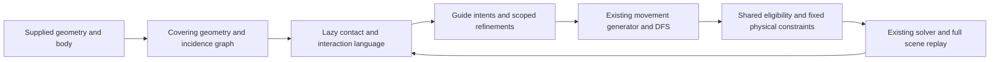

# Implementation plan: potential routes, relevant interactions, and shared progress guides

2026-11-03. Concrete follow-up to [the cited research](GENERIC_ROUTE_DISCOVERY_RESEARCH.md). Baseline: `a28e5b71`, isolated checkout `/private/tmp/parkour-real11-initial-run-ticks`, branch `research/real11-initial-run-ticks`. Implementation authorized after compaction. M1 domain/raw-incidence groundwork is implemented; later milestones remain pending. New APIs and schemas below remain proposed unless recorded in the status ledger; links to existing functions describe the verified baseline. The existing uncommitted research, navigation updates and routing-review figures must be preserved.

This is the controlling plan for the **next** route-discovery implementation. It supersedes the earlier spatial plan where that plan makes an ordered transit-box walk the route identity or requires every input to follow that walk. The implemented [spatial baseline](SPATIAL_CORRIDOR_REFACTOR_PLAN.md) and [DFS contract](DFS_INTERACTION_IMPLEMENTATION_PLAN.md) remain the source of existing behavior and protections to preserve.

## 1. Result we are implementing

Discover potential routes generically from the supplied collision geometry. Keep contacts, meaningful approaches and passages that could affect movement or progress. Remove an interaction only when a conservative check excludes it in the declared context; leave unresolved choices for movement construction and numerical solving. Route guides provide different progress interpretations without creating separate searches for equivalent ways of describing the same open space. [Research §§1–2,5–8](GENERIC_ROUTE_DISCOVERY_RESEARCH.md).

The architecture is:



Concrete changes from `a28e5b71`:

- Retain exact geometric primitives, exposed support regions, original collision data and the latent geometric connectivity graph.
- Replace the eager catalogue of independent complete air-box itineraries with a shared cyclic event graph and lazy next-goal/approach requests.
- A free-space connector holds **all its backing alternatives**, not one selected raw cell walk. Individual geometric paths provide guide witnesses only.
- Use actual contact episodes and obstacle-feature predicates for semantic events. A raw `open_portal` or `support_departure` does not by itself create a new scored decision or route family.
- Query interaction eligibility before constructing side/corner products. Keep a target's required landing while removing proved irrelevant premature avoidance of that target.
- Remove automatic per-input `RouteGuards` containment in a selected air-box walk. Retain physical avoidance, selected contact/approach constraints, required task conditions and independent full-scene validation.
- Maintain one execution owner for a compatible actual prefix/next-goal context. Alternative future guides do not each restart its B2/B3 solve.

This is a guide/discovery refactor, not a new physics model, mixed-integer solver, global time bound, global peer-retention pass, or sibling decision-transfer system. [Imported protections](SPATIAL_CORRIDOR_REFACTOR_PLAN.md#0-imported-baseline-and-integration-requirements), [research §7.4](GENERIC_ROUTE_DISCOVERY_RESEARCH.md#74-optimistic-guide-grouping-is-a-weaker-operation).

## 2. Non-negotiable contracts

### 2.1 Coverage and budgets

Define the modeled problem by the actual scene/body, initial state, input domain, supported movement catalogue, task predicate and any **explicit domain restrictions**. Every execution admitted by that model should retain an abstract representation. This is an overapproximation objective: a potential route can still be physically impossible. No claim of end-to-end completeness follows from the current local NLP or heuristic pruning. [Research §2](GENERIC_ROUTE_DISCOVERY_RESEARCH.md#2-what-all-potential-routes-should-mean).

Distinguish:

1. **Represented language:** the cyclic graph and its unexpanded connector/refinement alternatives.
2. **Materialized hypotheses:** the next-goal/guide requests currently generated.
3. **Realized programs:** discrete movements actually constructed.
4. **Fixed models and validated executions:** exactly what was solved and checked.

An unexpanded connector is not an absent route. A materialization, queue, deadline or numerical cap suspends its cursor. Do not silently use simple paths, `max_visits=2`, or an exhausted first batch as a global route exclusion. Cycles can represent repeated movement compactly; actual programs still obey their declared input/interaction limits.

The first release supports the current accepted scene/task/movement interfaces. Generic geometry does not silently enable intentional wall hits, water, new ladder behavior or unknown mechanics. Keep normal momentum, threshold zero, original-state re-solves and all earlier facings variable. Real11 keeps its descending height7 task with X<729.7, Z≥−1095.3, minimum achieved tick then maximum Z, no fake floor or opposite-side goal bounds. [Current task contract](../docs/REAL11_GUIDE.md), [`solve_scope`](solve_spec.py), [`InitialJumpDomain`](cell_routes/support_order.py).

### 2.2 Three different objects

| Object | Can be shared/grouped by | What it must not do |
| --- | --- | --- |
| Optimistic guide intent | Same required next event and compatible progress interpretation, with latent alternatives retained | Certify a particular passage or silently delete alternative movements |
| Semantic route refinement | Actual contact sequence and committed/observed approach or passage predicates | Include arbitrary raw-cell IDs, timing samples or representative anchor coordinates as route identity |
| Fixed-model/execution state | Existing exact program, scope, constraints, mode/resource and ownership identities | Merge different programs because their guides or endpoints agree |

Grouping guides is deliberately weaker than merging physical programs. An active `left OR right` condition stays a disjunction even if one shared guide services it. Only a proof of irrelevance or exact equivalence permits removing its physical obligation. [Research §7](GENERIC_ROUTE_DISCOVERY_RESEARCH.md#7-safe-pruning-and-merging-rules).

## 3. Explicit design decisions

These settle the research's open choices sufficiently to implement the first version:

1. **Geometry backend:** keep `geometry.decompose`, its raw cells/contact patches and exact incidence as the coverage substrate. Keep `free_transit_cover` as an optional guide-path accelerator. Do not make its overlap-walk identity a prerequisite for acceptance. Do not replace it now with IRIS, GCS, a sampled roadmap or a new full-state decomposition.
2. **Route abstraction:** a cyclic event graph whose free-space edges are backing graph languages. Unrefined air travel is silent in the outer contact word; its geometry remains available for later passage refinement.
3. **Contact semantics:** use physical support visits and supported named events, not every per-input ground-contact row. Ordinary running on a connected coplanar surface is local movement. Preserve actual input/contact rows in the program even when an outer label is silent.
4. **Passage semantics:** labels come from physical obstacle features and selected avoidance/approach predicates, including vertical layers and their ordering. Ordinary XYZ homotopy is not the equivalence oracle. Unproved equivalence retains alternatives in a shared unresolved connector.
5. **Approach branching:** initially latent; instantiate in a scoped movement context through the shared interaction helpers and existing face/corner builders. Unknown results retain choices.
6. **Progress:** guides are preferences and warm-start geometry. Achievement of a support or selected passage requires an actual event/predicate. The initial release continues to compare time at support goals and the task finish; it does not introduce new mandatory portal clocks or epsilon boxes.
7. **Hard constraints:** actual selected movements, contacts, task conditions and cap-compliant physical avoidance remain fixed before a solve. Raw cell containment is removed from the new automatic path, together with any associated hidden eligibility or acceptance filters.
8. **Search ownership:** shared prefix ownership is established before future passage choices split. Do not copy a chosen child's decisions from an independently solved sibling. Different actual prefix programs retain separate owners.
9. **Caching:** first release shares immutable geometry and exactly keyed construction products, not cross-route numerical incumbents or mutable solver/frontier cursors.
10. **Coverage claims:** measure geometric union/incidence, represented event language, generated work and physical replay separately. No global minimal route partition or all-physical-routes theorem is a release claim.

## 4. Proposed records and identities

Use JSON-serializable records with sorted canonical geometry and explicit schema/policy versions. Immutable domain data is stored once and referenced by IDs. Do not place the entire scene/graph in each route key, frame or callback snapshot. Reuse [`digest`](solve_spec.py), [`program_physics_key/program_search_key`](movement_composition.py) and [`geometry_key`](cell_routes/regions.py); do not round coordinates to merge objects.

| Proposed record | Required fields |
| --- | --- |
| `RouteDomain` | `schema`, `domainId`, scene/body/input/task identities, supported mechanics, declared domain restrictions, raw geometry reference, support/feature catalogue, `coverageStatus`, incomplete-build cursor/reason |
| `SurfaceGroup` | `id`, exact exposed patch union, height, physical component/owner/solid provenance, incidence, explicit owner-specific task subregions; physical components remain available |
| `ConnectorLanguage` | `id`, source mode/region set, target-event attachment, backing graph reference, admissible entry/exit attachments, latent path/refinement cursor, optional scoped exclusions, no selected raw walk requirement |
| `RouteEvent` | stable feature/contact identity; kind `support_visit`, `named_contact`, `passage`, or `finish`; finite event geometry/condition; required-versus-observed role; occurrence identity when instantiated |
| `GuideIntent` | `id`, semantic prefix/cursor, required next event, connector reference, latent future alternatives, guide witnesses, ordering metadata; `commitment=optimistic` for unselected passages |
| `InteractionRequest` | physical feature/solid set, role `required_contact`/`unwanted_contact`/`approach_prerequisite`, exact phase/window, complete scoped model key or unknown family context, contact/interior convention, owning event |
| `InteractionProof` | request/context IDs, `absent`/`not_ruled_out`/`unknown`, reason/method/tolerances, covered phases and mechanics, envelope/model hash, dependencies/owner, invalidation policy |
| `ApproachAlternative` | feature-face/corner sequence and applicable phase window, symbolic OR references, required owned event bundles, fixed rows only after instantiation, cap/resource consequences, refinement cursor |
| `GuideView` | immutable intent/refinement IDs, active semantic stage, finite guide regions/anchors, segment directions, achievement rules and common-comparison identity |
| `PrefixOwner` | actual parent program key, semantic commitments, next-goal request, task/scope/physics/resource/policy identities; compatible guide/refinement alternatives owned inside this frame |
| `ScoreView` / `ScoreRecord` | one comparison goal, objective/guide context and committed requirement set; record key combines physical candidate key with scoring context; independent repair/accepted-variant state per distinct view |
| `ObservedRoute` | actual physical events, known passages, unresolved classifications, association to optimistic intent(s), provenance and validation tier |

Identity rules:

- `domainId` includes actual geometry/body/task/method/input semantics; allocation size is not part of the physical domain.
- `semanticPrefixKey` includes required/observed meaningful events and ordered revisits. It excludes raw cell IDs, graph-walk spelling, anchor coordinates, optimized yaw and the initial jump restriction's incidental rendering.
- `guideId` may distinguish genuinely different progress directions while referencing the same owner and latent physical alternatives. It cannot stand in for an exact solve identity.
- `proofContextKey` includes original state/family, full proposed program where known, selected contacts/cases, phase windows, scope, geometry/body, all already enforced rows, probe uncertainty and admissible mechanics. First release reuses proofs only on exact keys; subset/generalization reuse is deferred.
- `PrefixOwner.key` includes everything that changes program generation, physical constraints, comparisons or continuation resources. Different future *preferences* can share it; different already committed approach conditions cannot.
- A timed face-chain gate change may create a different fixed model without creating a different untimed progress family. Keep both identities and exact requests.
- The same immutable physical candidate may have multiple scoring views. Store repair state, warm guesses and tried/accepted status on the corresponding score record; never overwrite one shared program's single `repairState` with an incompatible objective's continuation.

## 5. Geometry construction and latent connectivity

### 5.1 Retain the existing covering substrate

`build_route_domain(scene, task, budget) -> RouteDomain` will call the existing scene preparation, horizon-derived collision query, decomposition, contact extraction and support-component construction. Reuse [`collision_request`](cell_routes/route_queue.py) for virtual finish coverage; do not derive physical walls or guide anchors from the midpoint of its large query box.

Store raw cells, shared interfaces and physical incidence once. Every retained free point/contact attachment must remain represented after any acceleration or summary. A construction deadline leaves an incomplete domain, or resumes its build cursor; it must not turn missing geometry into a disconnected/impossible result. Existing `max_cells` failures stay explicit rather than truncating silently. [Research §8](GENERIC_ROUTE_DISCOVERY_RESEARCH.md#8-geometry-backend-and-graph-construction-recommendation).

The present overlapping cover preserves its raw base through expansion/containment. Keep that behavior until measured replacement is justified. Its boxes are guide witnesses/shortcuts, not new physical terrain or independent semantic routes.

Concretely, add `build_geometry_graph(decomposition, supports, task)` using the already extracted raw cells/portals/contact incidence. Refactor the legacy `build_route_graph` internals only enough to share the incidence/contact attachment code; its supplied schema2 behavior remains available. The new event domain starts from the raw covering graph and does not eagerly require `free_transit_cover` expansion. Build/cache overlapping shortcuts on demand as an accelerator, always retaining the raw backing path language. This avoids both expensive mandatory inflation and the old mistake of requiring one chosen raw-cell order.

Initial attachment is a set of all compatible raw regions/components, using the shared initial movement state. A grounded root may start at its actual support; an airborne root at the same coordinates must not acquire a fabricated support contact or jump permission.

Finite query bounds are coverage limits, not collision walls. A geometric disconnection can exclude a route only when the covered domain encloses every admitted relevant continuation, or the caller explicitly restricts that domain. Reuse/validate horizon-derived coverage in all required axes and supported probe modes. If enclosure is unknown, retain an unresolved outside-coverage attachment and request expanded geometry when available; do not manufacture a floor/ceiling or declare disconnected solely at the query boundary. A run with unresolved required outside coverage reports incomplete representation/validation.

### 5.2 Support groups and contact episodes

Keep existing per-owner `SupportComponent` records intact for physical builders and task references. Derive `SurfaceGroup` metadata for coplanar, continuously walkable exposed patches only when their connection is certified under the existing body/contact conventions. Preserve nonrectangular unions; never fill holes with an enclosing rectangle. A boundary-touch-only rim is not a positive-overlap landing or a certified walkable connection.

Group provenance can contain several owners. An explicit task requiring a particular owner/patch retains that guard even if the larger floor group is connected. A `landing` goal can expose all relevant physical members using the existing `blocks` alternatives; individual fixed proposals retain concrete finite contact boxes.

Event extraction distinguishes:

- Repeated grounding rows during running: no new outer landing event.
- Crossing an internal coplanar owner seam while continuously supported: no new route family; preserve the physical provenance and any explicit task achievement.
- Actual airborne-to-supported contact, a selected named step/contact changing support/mode, or achievement of an explicitly required support subregion: meaningful support/mode event.
- A same-neighborhood setup hop: may be silent in the outer guide, but its full physical program, elapsed inputs and resources remain. Leaving and returning through a meaningful passage or another support emits an ordered revisit.

If a grouping/contact-episode interpretation is unproved, keep the physical components and unknown alternatives. Do not reject movement because an optional grouping could not be certified.

### 5.3 Compile a backing graph language instead of complete box walks

`build_event_graph(domain) -> EventGraph` uses the existing region/transition graph as backing geometry:

```text
raw open portal         → silent geometric edge with exact shared cover/provenance
support departure       → silent connection to an outgoing travel attachment
physical support arrival→ potential support_visit event, verified by movement later
task finish             → finish predicate, never an artificial support surface
```

A connector between two events references the backing subgraph and entry/exit attachments, not a single path. An initial closure/query may discover candidate next supports/finish through silent edges, stopping at a selected first contact; a path that merely overflies another support does not consume that support event. Actual movement/contact validation decides which contacts occur.

Cache graph reachability/closure by immutable domain and attachment set. Record the backing relation used by any macroedge. Do not use a volume union or endpoint-only reachability cache as a proof of a particular contact/passage itinerary. An unrefined connector is explicitly optimistic and can include multiple height/side choices.

The outer graph remains cyclic. Silent graph cycles may be summarized for reachability without deleting their backing geometric alternatives. A loopless path is acceptable for an initial guide witness only; it is not a no-revisit restriction on subsequent movement or route refinements.

### 5.4 Feature predicates and passage alternatives

Build stable feature records from physical expanded faces, connected openings, exposed support components and named contact-builder provenance. Use canonical physical geometry and owner/component provenance; source raw-cell IDs are diagnostic references only. Preserve strict/interior contact conventions and existing clearances.

There is no new universal homotopy-class oracle. Root connectors retain an unresolved remainder whenever a finite set of guide witnesses does not exhaust their language. Before a movement context exists, feature-side choices are hints/latent alternatives unless a geometry-only predicate is proved sufficient. Once a proposed context exists, use the existing physical face/corner families to expose the relevant alternative predicates (§6).

A meaningful passage refinement stores an ordered physical feature-face/layer relation and the relevant entry/exit condition. Do not retain a change of transit-box key as a passage event merely because it happened during guide construction. Conversely, do not drop a distinct left/right or over/under relation just because both end at the same support. The backing connector remains available to recover unmaterialized alternatives.

For the first release, a committed passage must be expressible by the existing cap-compliant face/corner/contact constraint language or another explicitly implemented and checked finite predicate. A new geometric opening label with no corresponding compiler/checker remains an optimistic guide/observation, not a hard obligation claimed to be enforced. Add new predicate capabilities with their tests before using them to reject a candidate.

## 6. Shared interaction eligibility and early normalization

Extend `interactions.py`; do not create a separate route-only avoid-relevance engine. Proposed entry points:

```python
query_interaction(request, context, *, session, budget) -> InteractionProof
query_window(feature, role, windows, context, ...) -> proof plus per-phase results
normalize_alternatives(alternatives, proofs, context) -> alternatives and audit
```

### 6.1 Two levels of query

1. **Outer unknown context:** query only conservative information valid for every allowed realization represented by that node. Missing timings/modes/speed bounds return unknown. Existing ordinary proposal annotations remain ordering hints unless their bound covers every admitted mechanic/incoming-state family.
2. **Proposed/committed program:** reuse `InteractionGate.envelopes/query/required`, `reachable_envelopes`, and `block_interaction` over the full proposal from the original state. All facings stay free. Distinguish a pre-outcome approach query, whose named-case Y is intentionally unknown, from a fixed ordinary profile where tighter Y is justified.

Window queries cover **every relevant Y→X→Z phase**, player expansion and intended/unclipped probes where applicable. Include the role and `interior`/contact convention in the cache key: excluding interior side penetration does not exclude the required top-contact boundary.

### 6.2 Required versus unwanted versus prerequisite

| Role and result | Action |
| --- | --- |
| Unwanted interaction absent for the entire scoped window | Do not construct its face/corner alternatives or interaction-specific rows; keep other contacts and obstacles |
| Required contact absent | Reject the full proposed contact/movement; retain other candidate programs |
| Required named-case approach prerequisite absent | Reject that named-case proposal; do not erase its approach row and call the case feasible |
| Unknown / not ruled out | Retain its alternatives, possibly lazily; do not label it feasible |
| A row independently entailed by the full same context | Canonicalize through existing effective-row machinery, keeping its required event and owner/resource meaning |

The physical unwanted-interaction predicate can be vacuous while arbitrary generated left/right inequalities remain restrictive. Therefore the absence test belongs **before** those alternatives are created. Do not demand that every arbitrary face inequality be tautological before recognizing an irrelevant obstacle. [Research §7.2](GENERIC_ROUTE_DISCOVERY_RESEARCH.md#72-required-interaction-versus-unwanted-interaction).

### 6.3 Normalization order

```text
full movement/contact proposal
  → shared required-interaction screen
  → unwanted-interaction eligibility by affected window
  → omit absent items
  → lazily enumerate existing relevant face/corner alternatives
  → canonicalize exact rows + required events + remaining-resource effects
  → cross-obstacle products / fixed constraint assembly
  → numerical dispatch
```

Run the full-proposal screen before projecting/truncating to any comparison prefix. Ownership removes uncommitted future prerequisites when their event is removed; it never carries orphan future rows back into a child. Recompute/invalidate proofs when the projected model changes. Preserve explicit task rows and already committed event prerequisites. [Existing relevance/ownership contract](GENERATION_RELEVANCE_PLAN.md).

An exact merge preserves the union of admitted traces **and continuation consequences**. Equal anchors, endpoints, sample trajectories or landing lists are insufficient. If a union remains active, retain it as symbolic alternatives. A broader optimistic guide can service that union, but cannot remove its physical constraints at dispatch. Grouping guide descriptions does not rewrite named cases or discrete movement histories into normal flight.

### 6.4 One source of physical approach alternatives

The physical item/option iterator remains the sole source of concrete side/corner constraints. Expose its descriptor alongside its existing rows/resource witness, rather than enumerate a second copy in the route layer:

```python
prepare_interaction_item(request, proof, context, cursor) -> prepared descriptor
# Existing ConstraintVariants option/product machinery consumes this once.
emitted_variant = {
    'rows': ...,
    'selectedPassages': ...,
    'resources': ...,
    'semanticObservations': ...,
    'physicalContext': ...,
}
```

`semanticObservations` contains the physical feature/face sequence and relevant phase information; it is provenance, not another independently enforced obstacle item. `EventGuideView` classifies/refines that description and can construct a matching warm-start guide. An absent interaction emits no such obligation. Named builder alternatives retain their own required case/contact bundles and use the same normalization path.

Keep each call to `solve_contact_branches` within **one fixed comparison/objective view**, because its incumbent ranking assumes one objective. At a common landing goal, physical approach alternatives may share that fixed outgoing objective while using different approach warm starts. If a genuinely different progress direction is selected, create a separate `ScoreView` before numerical dispatch, with its own exact solve identity and repair state; do not change objectives halfway through one repair queue. A shared guide cannot combine differently interpreted objective values into one best record.

The new score-record identity is `(candidate_key(program), scoreContextKey)`. The parent program remains immutable apart from explicitly owned legacy wrappers. Promotion uses the selected record's actual validated program and constraints; it cannot combine rows or yaw from two scoring views. Construction caches can still share exact objective-independent products when their verified dependencies agree.

## 7. Lazy physical alternatives and budgeted preparation

Refactor the expensive preparation in `ConstraintVariants.__init__` into resumable item construction. The constructor should establish immutable context, item descriptors and saved state, not rebuild every obstacle's masks, face-chain cost tables and products on each allocation.

Proposed internal state for each physical item:

```text
feature/solid descriptor
phase scan cursor + exclusion proofs
relevant phase masks and required offsets
face scan / chain cursor
cost-table preparation cursor
option frontier + exact seen keys
resource/provenance summary
```

Checks occur between obstacles, phase batches, face-chain preparations and emitted options. Existing native/compiler operations remain atomic with bounded calls; an interrupted operation retains its input descriptor for retry and reports unknown. Do not dispatch a worker after the shared remaining budget is exhausted.

Make preparation reusable only under an exact verified construction key. Include every dependency used by the masks/bounds, required contacts, scope, physics and already committed rows. Cache immutable geometry/coefficients/envelopes/item preparations where exact equality permits; do not share mutable `pending`, `seen`, LP/solver objects, candidate tried flags or accepted-child owners.

Keep actual physical `passageCaps`/face-chain usage active. Eliminating raw corridor guards is not permission to skip all physical obstacle items or invent cap-free passage certificates. `selectedPassages`, cap witnesses and remaining resources must survive canonicalization even if some numeric rows are entailed.

Persist preparation progress across the existing local allocation. The baseline's 8-second `score_seconds` must not restart the same preparation from scratch or repeatedly serialize the full static graph. Keep total time/call/prefix limits; improve reuse/checkpoint boundaries rather than raising them.

## 8. Guides, stage advancement, and comparison rules

### 8.1 Constructing guides

`guide_for(intent, scoped_refinement, entry_context, domain, budget) -> GuideView`:

1. Choose finite entry/target regions from actual support/contact attachments and the next required event. For a virtual target, reuse its one-sided rows and nominal height without inventing goal walls.
2. Obtain an initial geometric path witness in the connector graph, using a stable shortest-path proxy for ordering only. A failed/limited witness search leaves its residual frontier unknown.
3. Choose points in actual entry/exit interfaces using local neighboring event references. Reuse `conditioned_anchor`; do not choose whole-air-cell or query-envelope midpoints. A selected side/corner refinement supplies its actual feature geometry.
4. Join successive interface points through their convex geometric pieces. Simplify a point only if the replacement segment is checked in the allowed connector witness and removes no required contact/passage event.
5. Derive horizontal segments with `horizontal_segments` and objectives with the existing `Checkpoint.objective` path. Vertical/contact achievement stays in its event predicate. Zero horizontal displacement does not invent a facing or extra input.

The resulting path is a guide witness, not a dynamically feasible trajectory or waypoint-equality constraint. Other connector witnesses remain latent. A different guide can be selected without deleting incompatible-but-unexplored physical programs.

### 8.2 Actual events advance the guide

Add `advance_events(cursor, program, candidate, scope) -> event/status set`, reusing current Y/X/Z trace and physical event extraction. The cursor stores semantic occurrences and any unresolved passage refinements, not a required occurrence for every raw air box.

- A support visit requires the actual finite contact/mode outcome. Nearby position alone cannot satisfy it.
- A committed passage requires its actual ordered predicate/owned model evidence. Preserve alternative entry/exit correlations; do not splice half of two incompatible passage variants.
- An uncommitted guide may classify the observed passage differently. Attach the observed refinement or retain an unknown classification; don't reject a physically valid execution solely for following another uncommitted guide.
- Unknown named-probe geometry remains unknown for predicates depending on those probes. It cannot remove the underlying movement family.
- Same-input landing then X/Z run-off is valid. Physical terminal contact can end at its contact phase; a virtual endpoint retains its full-input predicate.

Distinguish `physicalValid`, `requiredEventsSatisfied`, `taskSatisfied` and `guideClassification` in reports. Final acceptance requires full physics/task validation and actual required program/user conditions. A missing classification of an optional guide is not a physical failure. This does not authorize truncating a longer witness into an earlier finish without rebuilding owned scope and validating it through the existing terminal-goal path.

### 8.3 Comparisons

- Compare actual arrival times only at the same physical goal/event under compatible commitments.
- Use an outgoing progress objective only under the same guide/refinement/comparison context. Do not compare dot products measured along unrelated directions as if they were the same score.
- Different intermediate goals get scheduler service, not a dominance proof from comparing their unrelated arrival times.
- All completed executions share the actual terminal objective: minimum achieved finish tick, then the requested objective at that tick.
- Retain earlier unknowns, equal-run alternatives, accepted fixed variants and saved siblings as the existing DFS does. Preserve current latest-jump minimum-run policy and its unpruned control; no new global objective bound or exclusion pass is introduced.

Passages can change the guide stage during a trace and warm-start construction without adding mandatory comparison clocks. Additional passage-clock discovery is a separate extension, not hidden epsilon-box work in this plan.

## 9. Existing DFS integration and shared owners

### 9.1 New stage-provider protocol

The new automatic adapter exposes an explicit protocol rather than relying only on `hasattr(adapter, 'for_goal')`:

```python
initial_cursor(roots, domain) -> SemanticCursor
next_goals(cursor, parents, continuation, budget) -> lazy GoalRequest iterator
for_goal(request, cursor) -> immutable EventGuideView
advance(cursor, validated_child, observed_events) -> cursor alternatives
```

`GoalRequest` includes the actual support/task predicate, compatible intent set, connector reference, mandatory commitments and terminal flag. It does not require a complete future support list. All next-support/task alternatives remain in the event graph or goal iterator, including unknown ones. A selected next-support frame can restrict its normal landing opportunities to that target plus valid local setup; other targets are retained as other goal requests.

### 9.2 Exact DFS call-site edits

Extend `depth_first.search_goals`; do not create a second movement DFS.

| Existing site | New automatic behavior |
| --- | --- |
| `goal_list` / typed-route detection | Dispatch on explicit search contract; legacy supplied modes keep their current goal-list semantics |
| `frame(index, parents, parent)` | Add `goalRequest`, semantic cursor and owner key; `index` becomes decision depth for diagnostics, not a lookup in a fixed full itinerary |
| `stage_adapter` cache | Key by immutable request/cursor/refinement context, not index alone |
| `configure` | Apply declared next-goal/contact choices and shared InteractionGate; no raw corridor projection or air-walk prefix filter |
| `eligible` / `screen` | Check actual required semantic events, full-proposal ownership and shared relevance; retain alternate goal requests separately |
| `generate` | Existing persistent iterator, initial domain, ready streaming and prefix quota; next support/task stop conditions derive from `GoalRequest` |
| `score` | Resolve applicable approach/guide alternatives lazily, pass required physical goal and active guide context to `evaluate_program` |
| `terminal` / `final_frame` | Use explicit request/task semantics; no automatic finite-B7 suffix after virtual finish |
| scored `choose` / child open | Atomically publish chosen validated child and its owner, then lazily request next goals from its semantic cursor |
| backtrack / suspended / refinements | Preserve existing single execution ownership and every unresolved generator/repair state |

The frame groups compatible future guide hypotheses **before** materializing independent owners. A hypothetical B4→B5 versus B4→B7 preference does not force duplicate B1→B2 scoring if nothing before B2 differs physically. Different actual parent programs, required approach conditions, scopes or continuation resources remain separate owners. No optimized endpoint is frozen or numerical child transferred across independently solved siblings.

### 9.3 Outer allocation

Refactor `route_queue.search_routes` to allocate event-graph/goal requests and existing DFS owners, instead of one full DFS per raw air walk. Preserve its public return/report envelope where practical, but give the new search state a new kind/schema.

Continue a newly committed child in the next bounded allocation. A stalled owner retains its cursor and yields to other ready goal/refinement/owner work; an untried guide cannot permanently hide behind optional refinement of an already served one. A complete task's additional refinements do not impose a global drain barrier.

Persist a deterministic service cursor and age/service counts. They affect ordering only. Do not evict old unknowns or change a running owner's mandatory language when another guide is discovered. Adding an optimistic alternative to the domain is separate from mutating an immutable frame's required commitments; fork a new request when those commitments actually change.

## 10. Fixed solve and acceptance changes

Introduce an `EventGuideAdapter` implementing the stage-provider and evaluation interfaces. It should not inherit the legacy projection-based block filtering implicitly. Extract/reuse only neutral event/geometry helpers where useful; preserve the old adapter for explicit legacy controls and source-era diagnostics.

At `checkpoint_search.find_checkpoint_route`:

- No authored corridor/points: build/load a session domain and event search state, once per run/resume.
- Explicit supplied schema2 corridor: retain its existing semantics as a diagnostic control.
- New event-guidance input: select the new adapter explicitly, with its domain reference and request.
- Keep `InitialJumpDomain` independent of route discovery. A fixture's `[0,8]` is an explicit control; generic code does not assume it.

At `evaluate_program`:

1. Keep `compile_program`, `schedule`, vertical validation, coefficient compiler, scoped original-state envelopes and floor checks.
2. Build the new shared relevance/refinement descriptor under the full proposal context.
3. For the new adapter, do not attach `RouteGuards` or a raw-cell crossing signature to `ConstraintVariants`. Do attach any selected physical passage/contact requirements and their ownership.
4. Run the existing physical obstacle/floor/case alternatives with early normalization and resumable preparation (§7). The full supplied scene remains independently checked.
5. Pass the active, already selected guide objective through the existing compiled `guideObjective` path. If a branch changes its objective, it is a new solve identity and its coefficients/envelopes must be reused only under their actual valid keys. Never rank branches with mismatched objective meanings.
6. Audit physical validity and required events separately from optional guide classification; record scope and exact numerical attempts as before.

Delete all automatic-path dependencies on inherited `box_allowed`, `region_allowed`, projection-derived `blocks`, raw `prefixFilter`, `program_states` tied to the first complete corridor variant, and full air-walk `advance` completion. Replacing only `RouteGuards` while leaving one of those rejection paths active is not an acceptable implementation.

Keep configured physical face-chain/contact/blockage limits. Keep full-proposal required-event screening and owned-row projection. A time budget or local numerical unknown remains unresolved; it is not a global event-edge no-good.

## 11. New modules and reuse map

Prefer these small responsibilities; split a proposed module further only if implementation size warrants it.

| File | Work |
| --- | --- |
| `cell_routes/event_routes.py` — new | Records/keys for domain, connector/event language, intents/cursors; geometry-to-event graph compilation and persistent lazy next-goal/refinement iteration |
| `cell_routes/guides.py` — new | Local geometric guide witnesses, latent witness cursor, safe simplification, active guide stages and objective derivation |
| `cell_routes/event_adapter.py` — new | Immutable stage provider; actual event classification/required-event checking; no inherited air-cell filters |
| [`geometry.py`](cell_routes/geometry.py), [`regions.py`](cell_routes/regions.py) | Reuse coverage/contact/incidence functions; add raw `build_geometry_graph`, stable feature/surface metadata and immutable domain construction; overlap cover is optional acceleration |
| [`interactions.py`](interactions.py), [`reachability.py`](reachability.py) | Shared window/role requests, proof keys/records and exact-context construction reuse; preserve named-probe unknowns |
| [`constraint_variants.py`](constraint_variants.py) | Lazy per-item preparation, early eligibility/normalization, existing cap-aware physical products and serializable cursors |
| [`open_movement.py`](open_movement.py), [`stepping_generation.py`](stepping_generation.py), [`case_profiles.py`](case_profiles.py) | Keep existing physics and contact builders; use the shared query before irrelevant optional branches; preserve required approach ownership |
| [`route_progress.py`](cell_routes/route_progress.py) | Add semantic `advance_events`; reuse phase/event primitives; schema2 exact-cell audit remains available for old controls |
| [`depth_first.py`](cell_routes/depth_first.py), [`route_queue.py`](cell_routes/route_queue.py) | Extend current owners/stage source and shared domain references; replace eager automatic walk catalogue |
| [`checkpoint_search.py`](cell_routes/checkpoint_search.py), [`block_contacts.py`](block_contacts.py) | Wire new adapter/refinement source and selected constraints; preserve physical acceptance and exact request evidence |
| [`comparison_goals.py`](cell_routes/comparison_goals.py), [`checkpoints.py`](cell_routes/checkpoints.py), [`terminal_goals.py`](terminal_goals.py) | Existing physical/virtual goals, landing alternatives, directions and arrival semantics; no new fixed portal clocks |
| [`solve_spec.py`](solve_spec.py), [`movement_composition.py`](movement_composition.py), [`movement_frontier.py`](movement_frontier.py) | Actual identities, ownership/truncation, persistent generator; add only explicit policy/context hooks needed by event search |
| [`automatic_experiment.py`](cell_routes/automatic_experiment.py), [`coverage_audit.py`](cell_routes/coverage_audit.py) | New automatic entry/state, tiered coverage reports and witness classification after unseeded discovery; old reports stay unchanged |

## 12. Persistence, versions, and configuration

Proposed initial versions: event domain1; event graph1; semantic guide/cursor1; event-search state1; proof policy1; new automatic DFS schema7; constraint-generation state2/context6. Both legacy DFS modes also fingerprint any changed shared constraint-generation policy so old inner cursors cannot be resumed accidentally. Existing generation context3 continues to exclude allocation fields duplicated in `scene.movementSearch`.

New event-search checkpoints store:

```text
domainId + one immutable domain/graph table
event/guide discovery cursors and residual connector languages
goal request registry and service cursor
owner registry: stack/suspended/refinements/records/accepted variants
proof records keyed by exact scope/context
in-flight item/phase preparation and fixed solve state
incumbent + actual validation/task classification
budgets/session counters + policy IDs
```

Separate immutable domain references from serialized work state. Progress callbacks should checkpoint changed mutable owners/cursors; serialize shared geometry once, not by repeated nested deep copies. A final snapshot contains enough static data for a portable report. Compiler/process/session caches are not serialized; their loss after reload changes preparation cost, not search semantics.

Reject incompatible schema2-corridor/schema6-DFS automatic continuations explicitly. Do not reinterpret old cell-walk keys as semantic event prefixes. Historical reports remain readable and reproducible at their own source; any offline diagnostic conversion must say it is not an exact continuation.

Configuration gets an explicit new event-search section/schema rather than silently changing old parameter meanings:

```json
{
  "discoverySettings": {
    "version": 1,
    "maxGraphExpansions": 5000,
    "maxGuideMaterializations": 50
  }
}
```

`find_checkpoint_route` adds `discovery_settings=None`; the no-authored-corridor entry defaults to this event backend after M5. `automatic_experiment.run` reads the new `discoverySettings` section. The two numerical defaults above deliberately reuse the old work-guard magnitudes, with their changed semantics recorded: graph expansions and newly materialized guide/score-view requests are per-session work quotas, their residual cursors survive, and cache retrieval of an existing intent does not create another materialization. Time/call/prefix limits still bound the whole session. Neither field limits the represented graph language or permits dropping an old owner.

Legacy `spatialSettings` must not be silently reinterpreted. The new CLI/API diagnoses that old catalogue setting and points to the explicit fixture migration. Old supplied-schema2 controls remain available; historical no-corridor catalogue reproduction uses its source-specific runner/revision. Update current automatic tests/fixtures to the new keyword/section as part of M5, and keep parser rejection/round-trip tests. This is an API/policy cutover, not a production feature-flag rollout.

- Physical/movement limits (`maxInputs`, allowed methods, explicit task/contact restrictions and physical blockage caps) retain their meanings and values.
- A guide/frontier materialization limit bounds work emitted in one allocation/session; the residual language/cursor remains saved. It is not an assertion that unmaterialized routes do not exist.
- Legacy `max_routes/max_steps/max_visits` remain documented for the old catalogue controls. Do not quietly reuse them as different new settings. If a caller explicitly imposes a semantic depth/revisit restriction, report coverage relative to that restriction.
- Use existing numerical/time/prefix settings for initial matched runs; record the changed routing policy and any new work-guard mapping explicitly. No performance result may be credited to a silent input-domain or budget increase.

## 13. Concrete B2→B3 acceptance example

Use generic fixtures parametrized by source/target height, target horizontal distance, incoming velocity family and an optional neighboring obstacle. Real11 labels are explanatory only; production rules contain no B2/B3 IDs, absolute coordinates or arrival ticks.

For an ordinary jump from height6 toward a height7 target, shared replay initially gives feet heights near6.42,6.75,7.00 and later a descending height crossing. This illustrates why target distance can matter before landing; it is not a complete side-collision proof. Reuse the exact command and scope in [research §6.1](GENERIC_ROUTE_DISCOVERY_RESEARCH.md#61-numerical-vertical-illustration-a-higher-target-has-a-vulnerable-approach-phase).

| Case | Required result |
| --- | --- |
| Target far from every applicable low-height swept phase | No premature target-side/corner alternative or corresponding owned avoid row; target landing contact/footprint still exists |
| Same target moved close enough for possible premature side contact | Preserve relevant left/right/corner alternatives and their unknown status; no unconditional free-flight fixed model through the target |
| Named step/grind outcome not chosen | Keep unknown probe-height coverage; ordinary replay must not exclude its required approach |
| Required target landing itself unreachable | Reject that full landing proposal; retain different targets/methods; do not delete the landing row |
| Left/right labels were only redundant spellings of an absent unwanted interaction | One ordinary-flight guide description with the same real contacts and other obligations; audit why the interaction disappeared |
| One alternative remains active or has different remaining resources | Keep its symbolic branch/resource outcome; sharing an optimistic guide does not erase its constraint |
| Incoming velocity/timing, scope or contact mode changes | Requery; the earlier absence proof is not reused under a block-only key |
| Full proposal is impossible but truncation would hide its future prerequisite | Reject before truncation; no orphan prefix model is emitted |

For the near case, preserve exact per-branch requests and actual passage/resource provenance. Do not measure success solely by fewer rows, fewer routes or matching optimized endpoints.

## 14. Milestones and implementation sequence

Each feature milestone bundles its implementation, meaningful tests, fixtures and current documentation in a local commit. Read-only baseline capture and this planning turn require no commit. Do not push or edit the other agent's checkout; shared native dependencies remain read-only.

### M0 — Freeze evidence and measure preparation

- Confirm physical worktree/branch/status and preserve all untracked research/figures.
- Use `a28e5b71` evidence as the source-specific baseline; do not resume its states under a changed policy.
- Add/report separate timers/counters for domain construction, coefficient compilation, reachability, item/guard preparation, physical products, copying/snapshotting, numerical wrappers and independent validation. Preserve the13-call/14.629s/303.290s facts without assigning unmeasured time to one function.
- Capture generic far/near/corner inputs and saved B4@41/zero-call B2 contexts under new output paths. A profiled replay is a diagnostic, not a seeded cold search.

**Exit:** a reproducible hotspot/identity report and exact settings; selected implementation priorities attributable to measurements.

### M1 — Immutable domain and semantic contact catalogue

- Implement domain/feature/surface-group records and stable keys on top of existing geometry.
- Add covering/incidence checks and explicit incomplete-build status; retain raw backing graph and task/owner-specific attachments.
- Implement support-episode extraction with ordinary running, setup hops, named contacts and explicit task subregions handled as in §5.2.
- Add immutable session cache boundaries and portable domain serialization.

**Exit:** geometry and contact-oracle tests pass, including equivalent box encodings and supported boundary cases. No route is discarded by a grouping failure.

### M2 — Scoped interaction results and early physical normalization

- Add role/window query and proof metadata to the existing InteractionGate path.
- Apply required full-proposal screening and unwanted absence checks before optional branch creation.
- Refactor physical item preparation to be lazy/resumable; preserve cap/owner distinctions and named probe uncertainty.
- Implement exact local normalization with audit records; test correction of restrictive face spellings for a physically irrelevant obstacle.

**Exit:** the far/near matrix in §13 and existing ownership/interaction regressions pass. Allocation interruption/reload loses no option and does not rebuild completed item preparation.

### M3 — Cyclic connector/event graph and guide witnesses

- Compile contact/finish events with latent geometric connectors; add closure caching and residual language cursors.
- Generate next-goal and conditional approach requests lazily, with no full itinerary catalogue required.
- Build guide witnesses and active stages from finite events/actual feature geometry; all alternative connectors remain recoverable.
- Serialize guide/discovery work independently from actual movement owners.

**Exit:** exhaustive tiny graphs preserve both support branches, left/right, over/under, landing/overflight and meaningful revisits; equivalent air-cover spellings do not force independent progress families. There is no global all-XYZ-homotopy claim.

### M4 — Existing DFS and fixed-solve integration

- Implement EventGuideAdapter/stage-provider; extend the call sites in §9.2 and new owner registry.
- Wire shared domain once per session; remove all automatic raw-cell filters listed in §10.
- Keep selected physical requirements in the existing model product; derive branch-specific guide/objective identities correctly.
- Preserve ready streaming, strict prefix quotas, initial domains, minimum-run policy, atomic promotion, accepted variants, suspended/unknown work and actual child adoption.
- Reject old continuations with explicit policy/schema diagnostics.

**Exit:** generic native finite/virtual/turning/approach cases pass independent replay and semantic event checks. Two future guide aliases cannot restart one compatible B2 prefix owner; different actual parent programs remain distinct. All existing explicit supplied controls retain their semantics.

### M5 — Default automatic entry, diagnostics and performance work

- Switch no-points/no-corridor automatic entry to event search after M1–M4 gates, retaining explicit supplied controls as diagnostics.
- Use M0 measurements to finish exact construction reuse and bounded preparation/callback serialization. Do not add a different solver or cross-sibling decision cache as an expedient.
- Update CLI cold/resume, reports, route/constraint counters, full corridor/event diagrams and source hashing for every changed runtime module.
- Clearly report represented/latent/generated/scored/validated quantities and every materialization guard.

**Exit:** no independent DFS is created merely for an alternate air-box witness. Exact duplicate construction and owner invariants are demonstrated by counters; no fixed wall-clock speed threshold is put in a unit test.

### M6 — Final acceptance and feature handoff

- Run the generic matrix and focused/native regression suites, then a fresh source-stable broader gate matching the baseline's recorded47-module scope. Record actual tests/failures/skips; dedicated ladder exclusions remain explicit.
- Re-run unseeded stored-Real11 witness coverage using the new event language, including the same-input B2 landing/run-off prefix. The archived trajectory enters only after discovery.
- Report that coverage at three distinct levels: raw geometry admits the trace; its semantic contact/passage projection is in the represented language; and a useful compatible guide/refinement was actually materialized without the reference. Acceptance by an undifferentiated unknown connector does not satisfy the materialized-guide gate. Then assess cold discovery separately.
- Run matched cold automatic/supplied controls with unchanged physical task, initial domain, movement/call/time budgets and documented new routing policy. Preserve all numerical requests and independent replays. Compare source-specific previous/new results without overwriting them.
- **Performance acceptance goal:** a full unseeded stored-Real11 finish within the existing300-second comparison budget, with physical/task replay passing. Do not require fixedT64 or claim minimum time. If it remains unknown, profile the remaining structural bottleneck, keep pending work, and report this acceptance item unmet; do not quietly widen caps or call representation coverage cold success.
- Update both implementation plans, current-state/navigation, research status, runbook/testing, evidence manifest and resume handoff. Commit implemented feature slices with their related docs/tests/fixtures/evidence; no documentation-only commit is required now.

## 15. Test and fixture matrix

These are new proposed tests under `autonomy/tests`; existing suites remain regression controls. Assertions compare meaningful geometry/languages/model constraints and ownership, not internal implementation spelling.

| Proposed suite | Required cases |
| --- | --- |
| `test_event_domain.py` | Equivalent obstacle splits/orderings; exact free-space/contact incidence; positive-overlap versus rim; connected coplanar runs and explicit owner task subregions; stacked/covered tops; incomplete build never certifies disconnection |
| `test_event_routes.py` | Both support branches; same landing list with distinct relevant passages; landing versus overflight; cycles/revisits; raw-air aliases sharing a connector; latent alternatives surviving guide limits; no cross-variant splicing |
| `test_interaction_normalization.py` | Far/near target-side windows; required landing retained; whole-proposal rejection; unknown intended probes; changed context invalidates proof; arbitrary restrictive face rows omitted for an absent physical interaction; active OR retained |
| `test_guide_progress.py` | Local anchors independent of remote query bounds; finite interface coverage; no required event shortcut; ordered advancement at revisits; same-input landing/run-off; physical versus virtual finish; unrelated directions never share a progress score |
| `test_event_search.py` | Single prefix owner for future guide aliases; distinct actual programs/scopes/resources not merged; dynamic next-goal requests; initial0/8 as explicit domain only; ready streaming/zero quota; atomic child callbacks; no old air-cell filter leakage |
| extended physical generator/continuation tests | Option-set parity for cap-compliant fixed physical models; interrupted masks/cost tables/products resume exactly; no repeated completed same-owner requests; cache keys include role/interior/phase/probe uncertainty |
| native generic integration | Flat gap, turn/obstacle detour, near higher target with corner alternatives, far higher target, bridge/underpass, airborne start, physical goal and free virtual overshoot; independent full-scene replay |
| saved evidence controls | Original B4@41 and zero-call B2 contexts for profiling; archivedT64 for representation only; fresh matched supplied/automatic runs for actual discovery |

For exhaustible cases, compare the projected event/constraint **union** under the same domain before/after normalization. Do not force preservation of an old overrestrictive face-grammar bug; use a physical trace/model oracle and record any restored coverage. For arbitrary maps, finite tests remain evidence, not an all-routes theorem.

## 16. Reporting and acceptance evidence

Every measured run records source revision plus changed runtime hashes, fixture/body/input/task/mechanic settings, declared domain/work limits, compiler/worker context, exact resume policy and actual wall time. Preserve each numerical request, validation scope, selected physical constraints, unknown reason and replay tier.

Required counters/timers include:

```text
geometric cells/interfaces/support components and surface groups
represented event states/connectors and residual languages
guide intents/witnesses/materialized approaches and their service counts
raw descriptions → normalized semantic alternatives → fixed physical models
proof queries/cache hits/absent-required/absent-unwanted/unknown by phase
physical item preparation/resume/rebuild counts and cap/resource distinctions
unique prefix owners, guide aliases per owner, pending/suspended work
time in geometry/compile/reach/item/product/copy/report/solver/replay
first useful proposal, first accepted stage, first full task completion
```

A route plot must distinguish physical footprints, support domains, optional guide points, committed interaction predicates and actual validated trajectories. Show the complete B1-to-finish itinerary, not only a finish-area crop; provide full spatial extents separately for large cells. Do not label an unstarted, archived-witness-compatible family a newly solved route.

## 17. First coding session after approval to implement

1. Re-read this plan, standalone guidance and current status in the existing isolated worktree. Preserve the research/figure files. Inspect any newly provided **committed** solver handoff before integrating it; never import another checkout's uncommitted retry.
2. Freeze the baseline input/source IDs and produce M0's preparation/identity measurements under new paths.
3. Implement the M1 domain/contact contract as the first feature slice, with its generic geometry/event oracle and serialized domain reference. Keep old controls executable.
4. Implement M2 early interaction normalization/preparation next; validate the far/near/required-owner cases before wiring the new event search.
5. Continue M3–M6 without restarting research or inventing another DFS. Use milestone exits and actual failures to adjust the plan; document any changed contract before silently relying on it.

The user has now requested implementation. Continue through the milestone exits; do not treat the remaining proposed APIs as implemented. Preserve the old source-specific evidence.

## 18. Commands and artifact layout for implementation

Run from the physical repository root. Reuse the existing native worker/helper read-only:

```sh
export OPENBLAS_NUM_THREADS=1 OMP_NUM_THREADS=1
export PYTHONPATH="$PWD"
export PKC_IPOPT_PYTHON=/Users/arvindmurty/CS/ParkourCalculatorMod-ipopt-cell-routes/.venv-guidance/bin/python
export PKC_RUN_TICKS_COMPILER=/Users/arvindmurty/CS/ParkourCalculatorMod-ipopt-cell-routes/standalone/autonomy/build/compiler.json
```

After the proposed test modules exist, the focused gate is:

```sh
"$PKC_IPOPT_PYTHON" -B -m unittest \
  standalone.autonomy.tests.test_event_domain \
  standalone.autonomy.tests.test_event_routes \
  standalone.autonomy.tests.test_interaction_normalization \
  standalone.autonomy.tests.test_guide_progress \
  standalone.autonomy.tests.test_event_search \
  standalone.autonomy.tests.test_orchestrator_continuation \
  standalone.autonomy.tests.test_depth_first \
  standalone.autonomy.tests.test_semantic_search -v
```

For the broader native gate, load the exact baseline module list from `experiments/automatic-corridors/allocation-context-final-native-2026-11-03.json`, union it with the new suites, and write a fresh text log/JSON summary. Include test-source hashes and all changed production-source hashes, timings, skips and actual counts. Never claim the old420-test report covers new runtime.

Create `autonomy/experiments/event-route-discovery/` for this implementation's fixtures/scripts/evidence. Give each measured run a new source-specific subdirectory; retain original reports under `automatic-corridors/`. Proposed files:

```text
generic-fixtures/          # far/near/corner/bridge/underpass/cycle task data
real11-auto.json           # same physical task/domain/budgets; explicit new routing settings
profile_saved_contexts.py  # M0 construction timings, not a cold discovery runner
compare.py                 # fresh automatic/supplied arms and independent replay
<run-id>/manifest.json      # source/settings/native context + validation scope
<run-id>/timings.json       # instrumented preparation/worker breakdown
<run-id>/coverage.json.gz   # raw, semantic-language and materialized-guide coverage
<run-id>/automatic.json.gz  # full requests, states and actual outcome
<run-id>/supplied.json.gz
<run-id>/native.{json,log}
<run-id>/guides.{svg,pdf}   # complete course, event IDs and optional guides
```

Keep the current `automatic_experiment` CLI's `--input/--output/--resume/--compiler/--python` shape while wiring the new event backend. Its report must state the backend/schema so a schema6 report is not accidentally resumed as event search. Expand `source_hashes` to cover all affected production modules, including shared interactions/reachability/physical-generator changes; recording only `cell_routes/*.py` would be insufficient. Validate local documentation/manifest links and diagrams after each implemented feature slice.

## Implementation ledger

- M0: saved B4@41 / zero-call B2 diagnostic harness added under `experiments/event-route-discovery/`; preparation profiles are diagnostics without numerical dispatch or cold-search claims.
- M1 groundwork: immutable content-checked `RouteDomain`, raw `build_geometry_graph` sharing legacy incidence, exact surface groups with physical provenance, unknown query enclosure, airborne attachment and physical support-episode projection. New domain + legacy region suites:15 tests pass. Automatic entry still uses the old catalogue until M4–M5. Domain construction failures are explicit; fine-grained domain-build resume remains pending (no partial graph is accepted).
- Next: M2 scoped role/window normalization and serializable lazy physical preparation, then M3–M6.
