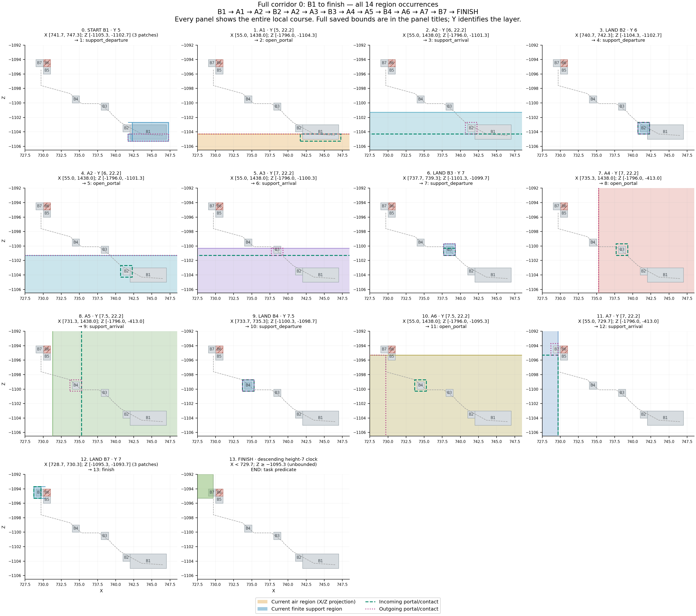
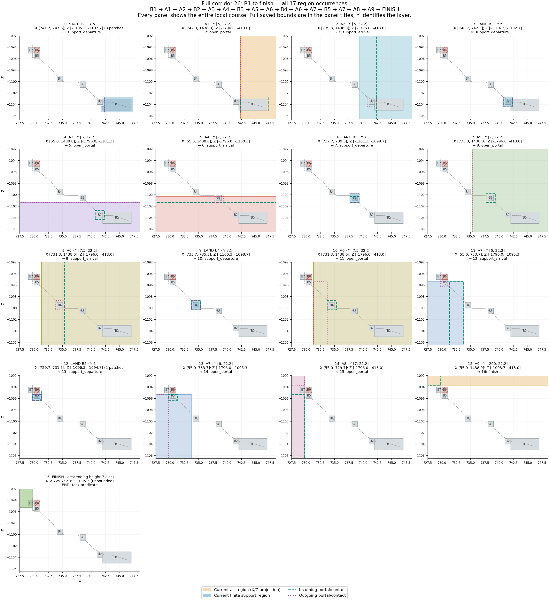
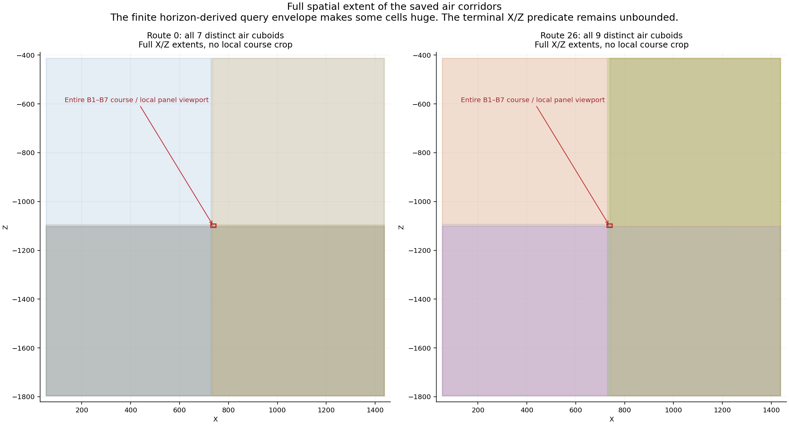

# Full saved corridors: every occurrence and portal

The previous cell diagram deliberately showed only the post-B4 approach. These atlases include every region from B1 to the terminal predicate. Occurrence numbers express order, not input ticks.

Local panels use the same full-course viewport. No region occurrence is omitted. Exact full bounds and transition covers are retained in [full-corridors.json](full-corridors.json); the separate extent figure removes the local viewport crop.

Grey: physical footprints. Colored fill: current region projected onto X/Z. Green dashed: incoming portal/contact. Magenta dotted: outgoing portal/contact. Air-region projections may overlap blocks at different heights; the Y range identifies the vertical layer. Multiple rectangles in a support panel form a union.

## Route 0

0:B1 → 1:A1 → 2:A2 → 3:B2 → 4:A2 → 5:A3 → 6:B3 → 7:A4 → 8:A5 → 9:B4 → 10:A6 → 11:A7 → 12:B7 → 13:FINISH

| Occurrence | Region | X bounds | Y bounds | Z bounds | Transition to next |
| --- | --- | --- | --- | --- | --- |
| 0 | START B1 | [741.7, 747.3] | 5 | [-1105.3, -1102.7] | support_departure |
| 1 | A1 | [55.0, 1438.0] | [5, 22.2] | [-1796.0, -1104.3] | open_portal |
| 2 | A2 | [55.0, 1438.0] | [6, 22.2] | [-1796.0, -1101.3] | support_arrival |
| 3 | LAND B2 | [740.7, 742.3] | 6 | [-1104.3, -1102.7] | support_departure |
| 4 | A2 | [55.0, 1438.0] | [6, 22.2] | [-1796.0, -1101.3] | open_portal |
| 5 | A3 | [55.0, 1438.0] | [7, 22.2] | [-1796.0, -1100.3] | support_arrival |
| 6 | LAND B3 | [737.7, 739.3] | 7 | [-1101.3, -1099.7] | support_departure |
| 7 | A4 | [735.3, 1438.0] | [7, 22.2] | [-1796.0, -413.0] | open_portal |
| 8 | A5 | [731.3, 1438.0] | [7.5, 22.2] | [-1796.0, -413.0] | support_arrival |
| 9 | LAND B4 | [733.7, 735.3] | 7.5 | [-1100.3, -1098.7] | support_departure |
| 10 | A6 | [55.0, 1438.0] | [7.5, 22.2] | [-1796.0, -1095.3] | open_portal |
| 11 | A7 | [55.0, 729.7] | [7, 22.2] | [-1796.0, -413.0] | support_arrival |
| 12 | LAND B7 | [728.7, 730.3] | 7 | [-1095.3, -1093.7] | finish |
| 13 | FINISH | <729.7 | height7 clock | ≥−1095.3 | END |

[Zoomable SVG](full-route0.svg)

## Route 26

0:B1 → 1:A1 → 2:A2 → 3:B2 → 4:A3 → 5:A4 → 6:B3 → 7:A5 → 8:A6 → 9:B4 → 10:A6 → 11:A7 → 12:B5 → 13:A7 → 14:A8 → 15:A9 → 16:FINISH

| Occurrence | Region | X bounds | Y bounds | Z bounds | Transition to next |
| --- | --- | --- | --- | --- | --- |
| 0 | START B1 | [741.7, 747.3] | 5 | [-1105.3, -1102.7] | support_departure |
| 1 | A1 | [742.3, 1438.0] | [5, 22.2] | [-1796.0, -413.0] | open_portal |
| 2 | A2 | [739.3, 1438.0] | [6, 22.2] | [-1796.0, -413.0] | support_arrival |
| 3 | LAND B2 | [740.7, 742.3] | 6 | [-1104.3, -1102.7] | support_departure |
| 4 | A3 | [55.0, 1438.0] | [6, 22.2] | [-1796.0, -1101.3] | open_portal |
| 5 | A4 | [55.0, 1438.0] | [7, 22.2] | [-1796.0, -1100.3] | support_arrival |
| 6 | LAND B3 | [737.7, 739.3] | 7 | [-1101.3, -1099.7] | support_departure |
| 7 | A5 | [735.3, 1438.0] | [7, 22.2] | [-1796.0, -413.0] | open_portal |
| 8 | A6 | [731.3, 1438.0] | [7.5, 22.2] | [-1796.0, -413.0] | support_arrival |
| 9 | LAND B4 | [733.7, 735.3] | 7.5 | [-1100.3, -1098.7] | support_departure |
| 10 | A6 | [731.3, 1438.0] | [7.5, 22.2] | [-1796.0, -413.0] | open_portal |
| 11 | A7 | [55.0, 733.7] | [6, 22.2] | [-1796.0, -1095.3] | support_arrival |
| 12 | LAND B5 | [729.7, 731.3] | 6 | [-1096.3, -1094.7] | support_departure |
| 13 | A7 | [55.0, 733.7] | [6, 22.2] | [-1796.0, -1095.3] | open_portal |
| 14 | A8 | [55.0, 729.7] | [7, 22.2] | [-1796.0, -413.0] | open_portal |
| 15 | A9 | [55.0, 1438.0] | [-200, 22.2] | [-1093.7, -413.0] | finish |
| 16 | FINISH | <729.7 | height7 clock | ≥−1095.3 | END |

[Zoomable SVG](full-route26.svg)

## Full spatial extents

[All pages as vector PDF](full-corridors.pdf). Exact input hashes and full-precision region/portal covers are in the JSON file above. No solve, route generation or runtime change was performed.
