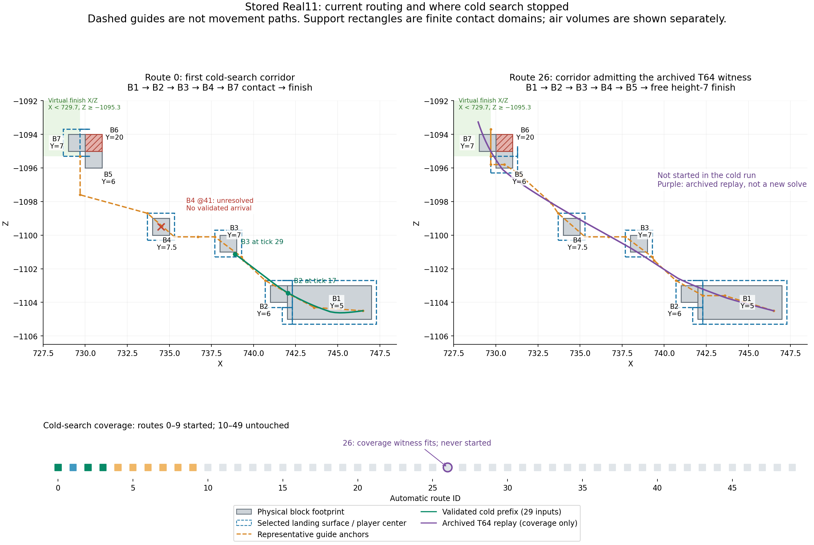
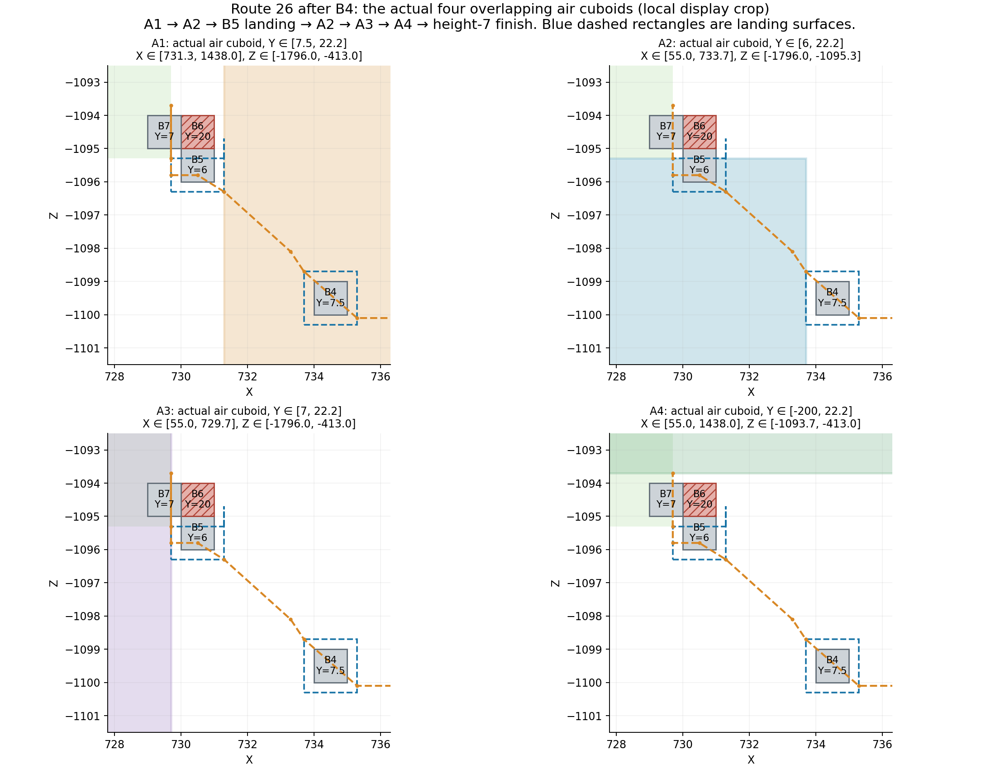

# Current routing and the cold-search bottleneck

Read-only audit of the final matched run at `a28e5b71`. No new solves or runtime changes. The [extraction/rendering script](inspect_routing.py) records input hashes and extracted facts in [routing-audit.json](routing-audit.json). Existing acceptance reports remain unchanged.

The left panel is automatic route0, the first attempted corridor: B1 → B2 → B3 → B4 → physical B7 contact → virtual task finish. Green is its validated29-input prefix; B2 arrival17 and B3 arrival29 come from the generated movement programs, not authored comparison clocks. Red marks the next required support, B4; there is no accepted B4 trajectory to draw.

The right panel is automatic route26: B1 → B2 → B3 → B4 → B5 → free descending height7 finish. Purple is the independently replayed archived64-input witness used only after unseeded enumeration. It fits this corridor, but this route was never started in the measured cold run. This is not a new cold solution or a prediction that this route would necessarily solve quickly.

Grey rectangles are physical block footprints; blue dashed rectangles are the exact finite player-center support domains, including clipping by neighboring obstacles. Orange points/lines are representative guide anchors and do not impose fixed waypoint equalities. Both panels use the stored seven-box scene; B6's reported right extension is still absent.

## Actual air cells

These are the four distinct air cuboids used by route26 after B4, each drawn in its own locally cropped panel. Their saved full X/Y/Z bounds appear in the titles. They overlap and can extend far beyond the local scene because query coverage comes from a conservative200-input travel envelope. No displayed crop becomes a constraint or creates terrain.

The ordered itinerary is A1 → A2 → B5 contact → A2 → A3 → A4 → finish. Re-entering A2 after contact retains a separate occurrence. A1 is above/east of B5, A2 above/south of B6, A3 west of B6, and A4 beyond its +Z face. This route's last passage permits the free endpoint to descend below height7 after clearing B6; physical B7 contact is a separate route.

## What the saved run establishes

| Item | Measurement |
| --- | --- |
| Search wall time |303.289865665s |
| Numerical solver-wrapper calls |13 |
| Sum of their recorded elapsed times |14.629353415s |
| Remaining wall time |288.660512250s,95.18% |
| Routes started |0–9 out of50 |
| Routes untouched |10–49, including26 |
| Deepest accepted support |B3 at29 |
| Next unresolved proposal on route0 |B4 at41, jumps at8/20/31, no named case events |

Solver-wrapper time includes startup, protocol, validation and cleanup. The remaining time is measured by subtraction; the saved run does not provide an instrumented split between compilation, reachability, route guards, physical-avoidance combinations, copying and report serialization. It would be incorrect to attribute the entire95% to one function or to IPOPT itself.

Specific evidence:

- Route0 reached B2@17 and B3@29, then tried three different fixed B4 models. All returned `unknown`; their solver-wrapper times total1.1784s. The saved constraint generator is not exhausted and is again inside item0, the route-guard generator. Its route cursor retains123 pending phase nodes. These are alternatives, not an infeasibility certificate.
- Routes2 and3 repeat the B2@17/B3@29 progression and leave B4@41 unresolved. Route1 leaves B3@27 unresolved.
- Routes4–9 each produce a B2@17 proposal but make zero numerical calls before their local allocation expires. Their constraint-generation and repair states remain saved. Model preparation can consume the local8-second allocation before solver dispatch; actual wall return may overrun a guard while completing work/checkpoint callbacks.
- Three B2 calls have physical problem fingerprint `a197d163…`; two B3 calls have `ea08c37f…`. The fingerprint excludes budgets, initialization and certain execution settings, so these are repeated physical models, not proof of identical full requests or validation contexts. Every request must remain independently auditable.
- The50 catalogue entries have only two support itineraries:30 through B1/B2/B3/B4/B7,20 through B1/B2/B3/B4/B5. The other route distinctions encode air-region passages. Overlapping cover walks can share large prefixes; a future equivalence audit must distinguish real obstacle/height choices from redundant cover descriptions before merging anything.

The strongest conclusion is that symbolic/model preparation and repeated per-route work dominate this run. Local B4 numerical unknowns also prevent advancement, but their three solver calls account for little wall time. Missing named step/grind probe geometry is not the cause of the observed ordinary B4 proposal, which has no case events.

The next investigation should profile construction of a saved fixed B4 model and the zero-call B2 allocations, then reduce redundant guard histories and shared-prefix setup where equivalence is demonstrated. Preserve contact/passage distinctions, physical blockage caps and exact continuation ownership. Longer IPOPT calls alone would address a small fraction of this measured runtime.

SVG exports: [overview](routing-overview.svg), [air cuboids](route26-air-cells.svg). This investigation does not require a feature commit under the standalone workflow.

## Complete corridors from B1 to finish

The earlier air-cell figure was a post-B4 zoom. The [complete corridor atlas](FULL_CORRIDORS.md) now includes all14/17 region occurrences and all13/16 transitions, including repeated visits, with the entire course visible in every panel. [Route0](full-route0.png), [route26](full-route26.png), [uncropped spatial extents](full-corridor-extents.png), and [vector PDF](full-corridors.pdf). The per-panel local viewport is only a display crop; full-precision region and portal bounds are in [full-corridors.json](full-corridors.json). All entries were checked against the saved route records.
