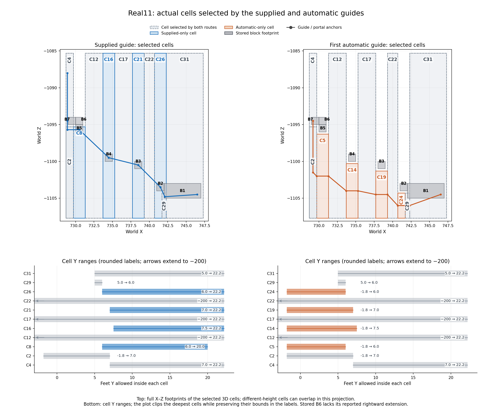

# Real11 candidate questions, answered in order

2026-11-03. This document answers the user questions sequentially. Each answer is written before investigating the next question. Evidence comes from the saved cold sessions and existing generator/scheduler; no search-policy change or new IPOPT solve is implied.

## 1. Are P01/P02 the primary candidates, and P03/P04/P05 continuations of P01?

Yes. They are two initial setup families within the same prescribed spatial route, not two different spatial routes:

| Program | Initial setup through state10 | Later committed/proposed inputs | Relationship |
| --- | --- | --- | --- |
| P01 | Jump at input0 | None yet at state10 | Initial immediate-jump family |
| P02 | Run inputs0..7; jump at8 | None yet at state10 | Initial delayed-jump family |
| P03 | Exactly P01 through10 | Return to B1 at12; jump12; land B2 at21; jump21 | P01 continuation to28 |
| P04 | Exactly P01 through10 | Same inputs/contacts as P03; extra B4 approach row at28 | P01 continuation; orphan future-condition issue already identified |
| P05 | Exactly P01 through10 | Same inputs/contacts as P03; different B4 approach row at28 | P01 continuation; same issue |

The position-Y, vertical-velocity, ground, jump and sneak histories through10 match P01 exactly for P03/P04/P05. Both P01 and P02 were retained after the state10 comparison. Choosing P03 for evaluation did not discard P02.

## 2. Why was P01 continued before P02?

“Prefix inputs” means the number of elapsed simulated ticks covered by the current partial candidate, counted from the original start. Each input is one tick of controls, including run, jump and air ticks. P01/P02 cover inputs0..9 and therefore have length10; P03..P07 cover0..27 and have length28. It is the partial-model horizon, not a measured completion time. All candidates compared at the same fixed checkpoint tie on this field; it does not establish which full route finishes sooner.

For numerical evaluation, the scheduler uses `(prefix inputs, -effective jumps, grounded run inputs, stable ID)`. It does not use the spatial-probe arrival time or promise to alternate initial families. This means the current first priority favors shorter simulated partial histories. Applying the user's fewest-ticks ordering to that quantity conflates search depth with time to a shared spatial goal. At one fixed checkpoint this field ties and cannot establish earlier route completion; this priority interpretation must be revisited as a scheduling issue.

| Candidate | Processing key, before stable ID | Consequence |
| --- | --- | --- |
| P01 | (10, -1, 0) | Lower tuple runs first among available candidates |
| P02 | (10, -1, 8) | Lower tuple runs first among available candidates |
| P03 | (28, -3, 0) | Lower tuple runs first among available candidates |
| P06 | (28, -2, 4) | Lower tuple runs first among available candidates |
| P07 | (28, -2, 5) | Lower tuple runs first among available candidates |
| Q02 | (28, -2, 8) | Lower tuple runs first among available candidates |
| Q09 | (28, -2, 10) | Lower tuple runs first among available candidates |

At state10, both setups have one jump, so P01's zero runs rank before P02's eight. At state28, P03/P04/P05 have three effective jumps and zero runs, so they rank ahead of the available delayed-setup continuations with two jumps. This is the explicit mechanical reason; no proof that the P01 family gives the best final route was used.

There are two meanings of continuation here. P02 was continued by the symbolic generator: its descendants exist in the ready queue. It was not continued by a main state28 numerical evaluation before the deadline. The saved20-program ready queue contains 13 initial-jump8 descendants and 7 initial-jump0 descendants. Some delayed-setup candidates reach B3 symbolically, but have not been numerically accepted.

The fixture sets fair_parents=true, but decision_windows.fair_programs explicitly sends persistent generation through one shared queue instead of its per-parent fairness loop. Therefore that setting did not guarantee a turn for P02. This is an ordering/coverage limitation, not evidence that P02 was worse or discarded.

## 3. Why were P06/P07 introduced before P01/P03 completed?

P06/P07 are other continuations of P01, not new primary setups and not descendants of P03:

| Branch | History after the initial jump0 | State28 |
| --- | --- | --- |
| P03 | B1 return12, jump12, B2 landing21, jump21 | Airborne toward B3 |
| P06 | B1 return12, run12..15, jump16, B1 return28 | Grounded on B1 again |
| P07 | B1 return12, run12..16, jump17 | Still airborne, no B2 landing selected |

The orchestrator generates a pool of sibling prefixes to the next fixed checkpoint. It does not finish one initial family or one promising prefix all the way to64 before considering siblings. P03's local state28 solve did finish: two worker calls produced an accepted physical prefix and its constraint source was exhausted. Its full route did not finish because advancing to state44 was blocked until the entire state28 window finished.

P06 was then evaluated, and its unfinished constraint source repeatedly re-entered the same available-work queue. Its key(28,-2,4) continued to outrank P07's(28,-2,5) and the available two-jump delayed-setup candidates with eight or more run inputs. Completing another8s evaluation chunk did not change that key. P06 received29 chunks; P07 subsequently received50. They consumed120 and44 main worker calls respectively.

Thus the problem is not that P03 needed more IPOPT work before it could be used. A window-completion barrier prevented using it downstream, while a static priority rule let unfinished sibling work monopolize the window. Saving the frontier made that work resumable but did not make scheduling fair. Changing only end-of-window retention cannot recover the time spent before that retention is reached.

## 4. Why were P06/P07 attempted at all?

Because the configured movement domain permits them, not because the primary candidates failed or a heuristic showed these waits were necessary:

- initialJumpInputs=[0,8] restricts only the first takeoff. It does not prohibit later run inputs.
- The fixture permits64 total run inputs and64 per jump. Normal generation tries jumping and not jumping when grounded, and visits every supplied support including the current B1. Repeated one-input supported returns therefore construct arbitrary waits; self-return jumps are also generated.
- SupportOrder permits repeated contacts with the current support. It requires the complete B2/B3/B4/B5 order only by terminal state64, not by the intermediate state28 checkpoint.
- The current dead-prefix test cannot reject grounded P06. Descending P07 can still have a first floor contact on B1, so it also survives. This test does not prove that the remaining mandatory support sequence can finish by64.

Both are locally legal proposed histories in that broad domain. Their relevant B1/B2 interactions cannot simply be discarded as unreachable. The shared early interaction fix therefore addresses their redundant/irrelevant constraint generation but does not, by itself, prove the entire timing family useless.

The implementation allowed later waits without establishing their usefulness and then spent most of the window elaborating them. Their poor observed progress/B3-arrival scores do not certify global inferiority, but they also do not justify exhausting them before giving other families numerical coverage. Any hard exclusion should follow a sound remaining-continuation argument or an explicitly agreed decision-domain restriction; provisional scheduling is a separate issue.

## 5. Was 8 the minimum run count? Why try16 run ticks and nothing between8 and16?

There is a numbering mix-up:16 and17 are absolute second-jump input indices, not counts of run inputs.

| Program | Jump inputs | Actual grounded nonjump inputs before state28 | Run count | B2 reached in main prefix? |
| --- | --- | --- | --- | --- |
| P01/P03 setup | 0, then12, then21 in P03 | None | 0 | Yes, P03 lands B2 at21 after a B1 self-hop |
| P02 setup | 8 | 0..7 | 8 | The saved spatial probe reaches B2 at17; main P02 ends at10 |
| P06 | 0,16 | 12..15 | 4 | No; returns to B1 at28 |
| P07 | 0,17 | 12..16 | 5 | No; still airborne at28 |

So we did not attempt sixteen run ticks in P06. We attempted a second takeoff at absolute input16 after four later run ticks. Eight is not a global minimum run count for reaching B2: P03 already reaches it with zero grounded nonjump inputs by using a self-hop on B1. If the question means the minimum for a direct single jump from B1 to B2, the current cold experiment does not establish it: first-jump0/8 was an explicitly selected domain, not the output of a minimum-run proof.

If “between8 and16” means first takeoffs9..15, those were excluded by the selected initialJumpInputs=[0,8]. If it means later takeoffs12..15, they were generated. These saved shorter prefixes remain pending expansion:

| Pending prefix | Jump inputs | Run inputs after B1 return12 | State / selected support | Numerically evaluated as a state28 continuation? |
| --- | --- | --- | --- | --- |
| F01 | [0, 12] | [] | 24 / b1 | No |
| F02 | [0, 13] | [12] | 25 / b1 | No |
| F03 | [0, 13] | [12] | 22 / b2 | No |
| F04 | [0, 14] | [12, 13] | 26 / b1 | No |
| F05 | [0, 14] | [12, 13] | 23 / b2 | No |
| F06 | [0, 15] | [12, 13, 14] | 27 / b1 | No |
| F07 | [0, 15] | [12, 13, 14] | 24 / b2 | No |

These are evidence of generation, not numerical feasibility or optimality. P03 is the already-evaluated immediate second-jump12/B2-landing21 sibling. The unexpanded22/23/24-input B2 prefixes could produce further three-jump continuations to28, but those are not yet main-scored. The first ready batch was not an exhaustive enumeration sorted over every possible future continuation: generation and numerical scheduling have separate queues. A full ready batch plus repeated numerical continuations prevented additional symbolic expansion from bringing every potentially higher-priority child into view.

## 6. Was the search effectively consumed by extraneous work?

Yes, the measured work was severely unbalanced. “Extraneous” here means over-elaboration and unproved-useful branches; it does not certify that every distinct P06/P07 model can be safely deleted.

| Initial family | Main worker calls | Spatial-probe worker calls | Total |
| --- | --- | --- | --- |
| P01 family (initial jump0) | 171 | 30 | 201 |
| P02 family (initial jump8) | 1 | 6 | 7 |

P06/P07 alone consumed164 of172 main worker calls (95.3%), plus12 spatial-probe calls:176 of208 calls overall (84.6%). All172 main worker returns were numerically feasible. The work included many distinct avoidance/route-repair constraint combinations for the same two movement schedules, not164 attempts to discover new takeoff times. Generation also spent substantial time on duplicate descriptions that never became fresh worker calls.

The three sessions spent about910 seconds and still never advanced beyond the state28 comparison window. That is a real structural coverage failure: P03's accepted prefix did not get a downstream completion attempt, P02's state28 descendants got no main numerical evaluation, and20 ready programs plus16 symbolic prefixes remained. It was not exhaustion of the whole route domain.

The causes are separable:

1. The declared domain permits unstructured later waits/self-returns. Initial0/8 restricts only the first takeoff.
2. Static prefix priority repeatedly selects already-started P06/P07 refinement over waiting candidates; fair_parents does not alternate families in persistent mode.
3. The fixed checkpoint window must drain before a promising accepted prefix advances, so later route completion cannot provide feedback soon enough.
4. Late interaction filtering/canonicalization and the orphan approach-row bug create unnecessary generation/refinement work.

The interaction-gate plan addresses item4. It does not by itself fix family allocation, the window barrier or prove all later waits useless. Those require an explicit scheduling/decision-domain plan rather than increasing budgets and assuming the current queue eventually gives useful coverage. No runtime change was made while answering these questions.

## 7. Why only initial runs0/8, rather than9/10/11?

Investigated at source `93652150`, 2026-11-03, in isolated branch `research/real11-initial-run-ticks`. No solver behavior or fixture was changed, and no new numerical solve was run.

The current cold fixture explicitly supplies `initialJumpInputs=[0,8]`. `fixed_clock_experiment.run` passes this list into `SupportOrder`; `SupportOrder.audit` rejects a program whose first grounded jump input is outside the list with reason `initial_jump_domain`. It also rejects a no-jump prefix once its horizon exceeds the largest listed input. This is a configured search-domain restriction, not a physical bound, a solver result, or evidence that all later takeoffs lose.

The source-era README attributes the restriction to the earlier decision to retain the immediate0 and delayed8 families while narrowing the pilot. Retaining those two useful families does not itself establish that they exhaust useful initial choices. This follow-up question reopens that coverage issue; it does not supply a new maximum initial delay.

| Initial grounded run inputs / first jump | What the saved evidence establishes |
| --- | --- |
| 0 / input0 | Current cold family; saved complete reference reaches Z64 approximately−1093.267553. |
| 8 / input8 | Current cold family; saved constructive continuation reaches Z64 approximately−1094.579584. |
| 9 / input9 | Excluded by the current fixture, but an older constructive continuation passed recorded replay through64, reaching Z64 approximately−1094.113304. Its B2/B3/B4/B5 arrivals were18/27/40/56. |
| 10 / input10 | Excluded by the current fixture; no tested complete continuation identified in the linked corpus. |
| 11 / input11 | Excluded by the current fixture; no tested complete continuation identified in the linked corpus. |

These are nonexhaustive best-found continuations, not independently optimal results for each initial delay. In particular9's saved result exceeds8's saved result; neither comparison proves the winning initial delay globally. Evidence for9: [constructive probe log](../../linkcraft11-opening/evidence/real11-constructive-probe.log), [original result table](../../linkcraft11-opening/README.md#a-concrete-failure-of-local-timeprogress-exclusion).

The first comparison is at state10 after inputs0..9. Jump9 can appear in that prefix. Jump10 or11 cannot yet appear there: both share an initial ten-input run prefix, which must survive the checkpoint and then branch into different takeoff times. `SupportOrder` can represent a broader allowed list, including a no-jump prefix at10 when the maximum allowed takeoff is at least10; that only removes this policy rejection. It does not guarantee generation, retention, numerical feasibility or downstream coverage under the existing search limits. Widening an eventual investigation should therefore preserve unfinished run prefixes and compare continuations at a common support/goal, rather than treating the state10 boundary or eight ticks as a physical cutoff.

There is no established physics or optimality argument here for excluding9/10/11. A wider initial-delay experiment is distinct from the solver/DFS fixes and should use a fresh fixture/output path, preserve the0/8 controls, and report finite tested coverage without claiming a complete timing search.

## 8. Why compare first at state10, and what was supplied rather than discovered?

Audited in the isolated investigation worktree at runtime source `93652150`, 2026-11-03. This describes that snapshot, not another agent's concurrent implementation. Documentation only; no numerical rerun or search change.

State10 is an explicit pilot choice. The original fixture introduced in `78fe99dd` already contained `comparisonTicks=[10,28,44,55]`. `fixed_clock_experiment.run` converts those literal ticks into `Checkpoint` objects. No code derives them from landings, turn completion, reachability, or a quiet interval. The archived execution audit calls them arbitrary absolute states; no defensible derivation of the particular number10 was found. Their operational purpose was to split generation/scoring/retention into intermediate fixed-clock windows before the requested terminal64 objective. That explains the mechanism, not why10 is a good boundary.

The first checkpoint runs after inputs0..9, while the immediate0 and delayed8 families are in different jump phases. In the old pilot, short-horizon pruning removed immediate0 even though it later supplied the best tested complete continuation. In the later cold corpus, both families survive10, but the state28 window barrier blocks further descent. Those are different failures of the same manually clocked orchestration, not a reason to treat10 as a natural decision boundary.

### Fixture choices and driver policies

| Item | Supplied behavior and consequence |
| --- | --- |
| Initial alternatives | `initialJumpInputs=[0,8]` excludes every other first grounded jump time, including9/10/11. |
| Comparison clocks | `[10,28,44,55]` cuts partial programs at authored absolute times. Checkpoint construction supplies no comparison region or required crossing signature and leaves `bounded_end=False`; an accepted stage does not establish turn completion. |
| Spatial route | Eighteen supplied `spatialPoints` choose one corridor via B2/B3/B4/B5 and left of B6. Decomposition is computed, but automatic route enumeration is bypassed. Coordinates such as X728.9 are authored guide values, not physical obstacle faces. Corridor/landmark restrictions then affect candidates. Earlier guide-extent clipping bugs are documented separately; do not report their old projection as the current repaired implementation. |
| Support order | `requiredSupports=[b2,b3,b4,b5]` requires those contacts in order by64; skipping/reordering is excluded. Repeated contacts with the current support remain allowed. |
| Scoring directions | The driver uses the normalized start→B5-center horizontal vector at10/28/44, then hard-selects +Z at the last comparison55. This is a driver rule, not the current guide segment or optimized direction. Terminal +Z is task-defined. |
| Spatial comparison goals | The fixture maps10/28/44/55 to B2/B3/B4/B5 landing probes. Probe arrival times are solved, not supplied. The historical first trial instead used B5 for every probe. |
| Movement domain | `types=[normal,stepping]`, `force45=True`, `sprint=True`, `incomingSprint=False`, zero intentional wall hits; this driver excludes ladders and other movement types. Ceiling is not selected in this fixture. These are selected capabilities/input assumptions, not proof that other movements are useless. |
| Ground waits | The fixture permits64 total/per-jump run ticks. Generic grounded jump/nonjump generation and same-support returns permit later waits/self-hops. This is much broader than the earlier simplified no-extra-run interpretation, despite the narrow first-jump list. |
| Physics model | The checkpoint driver explicitly uses inertia threshold0 while retaining normal momentum. This is the recorded modeling decision; coefficients, body dimensions and collision-phase rules come from shared physics/builders. |
| Work order and advancement | Source code prioritizes `(simulated prefix length,-grounded jumps,grounded runs,ID)` and drains a global checkpoint window before advancing. It does not select the next deep branch by achieved shared-goal arrival time. Persistent mode bypasses the per-parent fairness loop even with `fair_parents=True`. |
| Retention policy | Default `time_progress`, progress margin0.25 blocks, time margin1 tick, beam setting8 and unknown setting1. These are policy parameters, not physical dominance proofs. In this snapshot protected/deferred candidates can exceed the active beam; it is not a hard eight-history total. |
| Resource limits | Fixture:300 seconds; candidate2s; score8s; total numerical calls1024; score-call chunk6; final-call chunk24; spatial probe5s/6 calls/4 candidates/128 prefixes. Movement settings:64 input horizon,2048 expansions,384 queued prefixes,16 choices/type. Contact branch setting32 and passage candidate setting128 also bound work. In the persistent current path `max_candidates=20` fills the ready batch rather than limiting the entire window to20 evaluations. The older pilot did use a20-program per-comparison cap. Limits can leave work unexplored; they do not certify impossibility. |

The geometry/start state, declared coverage and empty unspecified space, maximumZ at absolute64, and optional B7 landing define the requested benchmark and its world assumptions. They need to be explicit inputs. In particular64 remains a legitimate terminal objective clock; questioning intermediate10 does not make the final task clock arbitrary. B7's `goalBlock` label is a catalogue reference in this mode, not a required landing.

### What the program actually determines

The decomposition/collision geometry is computed from supplied boxes. Within the selected domain the generic builders generate later jumps, waits, self-returns, landings, stepping possibilities and obstacle/contact constraint alternatives. Vertical landing offsets are computed from shared physics. IPOPT optimizes facings and resulting horizontal trajectories from the original state on every fixed-program solve. It does not choose missing discrete timing families that the outer filter excluded. No exact reference jump sequence, per-support arrival times, per-tick facing sequence or intermediate optimized state is imposed on a cold run. The saved successful constructive controls are separate nonexhaustive probes over selected starting families and0..3 later run delays, not autonomous cold-discovery results.

The approved DFS plan already replaces manually clocked global advancement with shared-spatial-goal comparison and persistent descent/backtracking; it is unimplemented in this audited snapshot. That plan alone does not broaden the explicit0/8 fixture domain or discover new spatial routes. This investigation changes neither plan nor runtime. Source pointers: [fixture](../../linkcraft11-opening/fixtures/clock64-orchestrator.json), [driver](../../../cell_routes/fixed_clock_experiment.py), [traversal](../../../cell_routes/checkpoint_search.py), [policy](../../../cell_routes/support_order.py), [movement settings](../../../movement_search.py), [source-era audit](../../linkcraft11-opening/EXECUTION_AUDIT.md).

## 9. Which requested automatic behaviors already exist?

2026-11-03. This follow-up corrects the task interpretation in sections7/8: the user now requests **earliest actual landing on B7, then maximum Z at that same tick**, with support order inferred from decisions. It also distinguishes implemented reusable components from features bypassed by the recorded Real11 driver. Runtime inspection remains at `93652150`; no concurrent solver edits were imported.

| Requirement | Existing implementation | Remaining work |
| --- | --- | --- |
| Choose a comparison tick from decisions | `decision_windows.plan_windows` merges supplied inclusive decision ranges/dependencies/readiness constraints and puts the checkpoint at the earliest onset of the next separate cluster. Tests cover timing ranges, coupled turns and dependency merging. | Real11 supplies literal checkpoints and bypasses this path. The helper requires opportunity ranges supplied by its caller; it does not discover the next unresolved decision/range from the scene. `score_features.quietFromState` describes an already chosen checkpoint, not a tick selector. Derive decision context/ranges where useful; the approved DFS uses shared spatial goals rather than making fixed-clock windows a global barrier. |
| Compute cells and discover a spatial corridor | `geometry.decompose` and `routes.enumerate_routes` are implemented; generic search calls automatic routing when no corridor/points are supplied. | Archived Real11 cold/constructive runs computed decomposition but supplied their corridor; no automatic-route Real11 solve was identified. Reuse this path with accurate geometry and validate generated corridors physically. Routing is bounded geometric guidance, not a dynamics/uniqueness proof. |
| Infer support order | `open_movement.normal_choices` proposes height-compatible supports using scalar physics; movement composition, corridor propagation and reachability/scene checks test concrete choices. No mandatory support list is needed by generic search. | Remove the experimental `SupportOrder` requirement from the new Real11 driver and derive subsequent goals from the branch's generated decisions. Existing early interaction screening is incomplete; do not translate a coarse not-ruled-out envelope into proven reachability. Preserve B1 setup self-hops while identifying B2 as the next useful forward support when actual reach checks establish that. |
| Compare at an appropriate shared spatial goal | `comparison_goals` supports explicit landing/region goals, validates achievements, measures arrival time and returns the actual selected program. A missing spec defaults to the final goal block. | It does not automatically select an intermediate common goal from arbitrary sibling decisions; the old fixture manually maps checkpoints to B2/B3/B4/B5. Wire branch/route decision context to shared-goal selection and promote the validated program as required by the DFS plan. Different next contacts may need a later common region/support to compare. |
| Compute progress direction | `checkpoints.horizontal_segments` extracts normalized horizontal directions from the corridor, skips vertical-only segments and merges collinear ones. `checkpoint` uses a selected segment and derives its prior crossing signature/turn boundary; default is the last horizontal segment. | The Real11 driver constructs explicit checkpoints using start→B5, then +Z, bypassing this helper. Connect the current ordered route/decision stage to the appropriate outgoing segment. Segment extraction exists; automatic stage selection is not supplied by `checkpoint` itself. |
| Minimize B7 landing time, then maximize Z | `ranking.candidate_rank` already returns `(ticks,-objective)` for a MAX objective. Generic movement search and non-fixed-terminal checkpoint search use it; landing mode requires a goal-support arrival, and continuous calls can maximize Z at their fixed candidate landing tick. | Replace the fixed-terminal driver configuration with landing mode and objective Z/MAX; do not impose `terminalTick=64` or the support-order filter. A maximum input horizon may remain a resource cap. Add an end-to-end Real11 regression for the corrected objective; best found time/Z is not automatically a certified global optimum. |

The user accepts the remaining modeling/budget restrictions for now; intentional wall hits are a future extension. Shared hit-event/contact machinery exists elsewhere, but this checkpoint driver rejects nonzero wall-hit settings, so enabling them later requires search/validation integration rather than only flipping a fixture flag.

### Automatic routing smoke check performed for this follow-up

The stored Real11 geometry decomposes into33 cells,92 portals and247 contact patches. A fresh call to `enumerate_routes` with **no authored spatial points and no support-order filter**, `max_routes=1`, `max_expansions=1000`, default depth64/visits2 and a10-second deadline returned one geometric corridor after72 expansions (~0.030 seconds). It stopped at `route_limit`, with317 queue entries remaining. This checks the existing automatic path on Real11's stored boxes; it neither solves the movement problem nor establishes that exactly one meaningful route exists. [Exact provenance/settings/corridor](../../linkcraft11-opening/audit/automatic-route-smoke-2026-11-03.json).

The user reports that B6 extends much farther right. Stored B6 is only `[730,0,-1095,731,20,-1094]`; no replacement extent was supplied. Correct full bounds are needed before using enumeration to assess the real obstacle's route alternatives. No extra geometry was invented and historical fixtures were preserved.

### Verification and scope

Thirty-five existing nonnumerical tests passed: `DecisionWindowTests`, `CheckpointTests`, `ComparisonGoalTests`, `CellRouteTests`. They cover opportunity-derived clocks, direction/turn handling, goal semantics and geometric routes. Source confirms time/Z ranking; this investigation did not run a new IPOPT search, certify B2-only reachability, or produce a corrected-objective Real11 solution. The associated current-state/decision/DFS-plan notes record the user's task correction; runtime files remain untouched.

## 10. How does the automatic corridor compare with the supplied one?

2026-11-03, runtime `93652150`; comparison source revision `6bfc20b8`. The same stored scene/decomposition is used for both routes. The automatic route is the first result saved in the section9 smoke check; the supplied corridor is rebuilt with current `corridor_for_points` from the historical fixture. No movement search or numerical solve was run. The user's updated commit practice is recorded in AGENTS: this investigation/plan remains uncommitted for bundling with a later implementation.

| Property | Supplied corridor | First automatic corridor |
| --- | --- | --- |
| Guide cell itinerary | 31→29→26→22→21→17→16→12→8→2→4 | 31→29→24→22→19→17→14→12→5→2→4 |
| B2/B3/B4/B5 midpoint crossings | Inside each expanded horizontal footprint strip (`side=0`) | South of each expanded strip (`side=-1`) |
| B6 midpoint crossing | South of B6 | South of B6 |
| Guide feet-Y range | 5..9 | approximately2.1..7 |
| Endpoint | `(728.9,7.2,-1088)`, beyond B7 for the historical fixed64 objective | approximately`(729.2,7,-1094.5)`, inside the B7 landing region |
| Geometric polyline length | 45.224990 blocks | 33.171508 blocks |
| Horizontal polyline length | 29.024990 blocks | 26.194386 blocks |
| Current horizontal projection | Exactly the same broad projection for both | Exactly the same broad projection for both |
| Ordered crossing signature | Matches the saved validated historical trajectory | Rejects that trajectory; first mismatch is B2 |

The endpoint difference means the lengths are not a shortest-route comparison to an identical target. Guide Y coordinates describe geometric free space, not an executable flight or fixed numerical altitude. The automatic guide descends below support tops and later rises to7; the geometric router does not know whether the movement program can do that. In current code both projections are broad free-space projections, so the meaningful restriction difference here is the ordered side signature, as well as different directions from their guide points. Both corridors have empty `stage_paths`; an active stage cursor is not already supplied by the forward adapter for these records.

The updated diagram shows the selected cells' actual X–Z rectangles and their feet-Y intervals. Automatic guide markers are the original start, shared-portal midpoints and a point in the terminal landing-region/cell overlap; they are not cell centers. Supplied markers are authored waypoints. Seven selected cells are shared. The supplied route additionally selects C26/C21/C16/C8 above the supports, while the automatic route selects C24/C19/C14/C5 to their south with upper Y bounds6/7/7.5/6. The JSON's `cellVisualization` records every selected cell's full-precision AABB. Projected rectangles can overlap when cells occupy different heights; they depict selected cells rather than the broader `corridor.projection` guard.

The saved64-input historical reference was checked with current `routes.audit_candidate` using its CSV X/Y/Z states. It passes the rebuilt supplied corridor and fails the automatic corridor with `reason=corridor_signature`, `mismatch=1`. This is a corridor-coverage check of an existing physically validated witness, not a new physical validation or a solution to the corrected B7 task. [Exact route comparison, hashes and audit verdicts](../../linkcraft11-opening/audit/corridor-comparison-2026-11-03.json).

A separate geometry-only call with the existing enumerator defaults (`max_routes=50`, `max_expansions=5000`, depth64, visits2, deadline10s) returned50 signatures after810 expansions (~0.150 seconds), stopped at `route_limit` with2604 queue entries, and produced **zero corridors accepting that saved reference**. This does not establish50 executable alternatives or that the real map has more than one useful route. It identifies the same geometric portal-midpoint/incidental-support-crossing coverage limitation already documented in the earlier multi-support experiment. [Default-shortlist evidence](../../linkcraft11-opening/audit/automatic-route-defaults-2026-11-03.json). No cap was widened beyond the enumerator's existing defaults.

Therefore replacing the supplied route with the first automatic result is insufficient. The three requested support/goal/direction integrations mostly reuse helpers, but automatic routing needs a separate coverage correction before claiming autonomous Real11 discovery. The [consolidated plan sections2.1–2.4](../../../DFS_INTERACTION_IMPLEMENTATION_PLAN.md#21-integration-plan-infer-support-order-from-generated-decisions) give the exact helper calls, small missing selectors, fallback behavior, implementation sequence and regression scope. The stored B6 still lacks its reported rightward extension; no new geometry was inferred.

## 11. Are large air cells and negative-Z block cells built into decomposition?

2026-11-03, runtime `93652150`. The user requested investigation of support-aligned cells and air anchors between neighboring block regions. Source inspection, geometric/reflection probes and a local partition diagnostic were performed; production geometry/routing and numerical solvers remain unchanged.

### Current construction

`geometry.decompose` expands each physical box by the player half-width in X/Z and body height below its Y minimum; shrinks declared coverage for the body; subtracts expanded open interiors by sequential X/Y/Z slabs; merges adjacent pieces that form a cuboid; and retains exact boundary strata. Pairwise cell intersections supply portals. Physical face intersections supply `ContactPatch` records with owner and support/ceiling/wall semantics. Cells contain free player reference positions. They are not physical blocks and are not uniformly grounded regions.

Large air cells are the remaining free volume inside declared coverage. Some span Y−200..22.2 or almost the entire Z extent. That is geometrically legitimate; it is not a claim that the player can fly freely throughout them. The implementation already has the finite exposed top support patches needed by the user's requested landing anchors:

| Support | Top plane | Cell containing its finite exposed top patch |
| --- | --- | --- |
| B1 | Y5 | C29 and C31, preserving the corner union |
| B2 | Y6 | C26 |
| B3 | Y7 | C21 |
| B4 | Y7.5 | C16 |
| B5 | Y6 | C8, clipped by B6's occupied footprint |
| B6 | Y20 | C10; existence is not evidence it is reachable |
| B7 | Y7 | C4, clipped by B6's occupied footprint |

The lower side cells are also valid free space and must not simply be deleted. `enumerate_routes` selects them as part of a geometric point-connectivity route, without requiring the necessary movement/contact sequence. It uses full portal midpoints to order/represent that route. There is no fixed negative-Z branch: reflecting the stored scene in Z gives33 cells/92 portals and a mirrored first route on the positive-Z side, again after72 expansions. Both sides remain available in decomposition; the existing route test also covers both sides and overflight.

### Measured anchor defect

Even the correct above-support itinerary C26→C22→C21 has bad raw midpoint guidance for B2→B3. The two full portal patches span Z−1107.7..−1085.3 and Y6/7..22.2. Their midpoints are `(740.7,14.1,-1096.5)` and `(739.3,14.6,-1096.5)`, far from the finite support centers `(741.5,6,-1103.5)` and `(738.5,7,-1100.5)`.

Extending only empty coverage by10 in +Z moves those midpoints by5 in Z. Extending only the ceiling of coverage by10 moves them by5 in Y. Both support patches stay unchanged. Thus the anchor problem persists even if the useful cell sequence is selected; geometric midpoint ranking is sensitive to irrelevant empty scene bounds.

A geometry-only diagnostic through the exact same cells and portals uses an air anchor `(740,7,-1102)` between the supports. It lifts the source reference to the higher top, intersects the straight X/Z support connection with the portal faces, and retains the actual support endpoints. `segment_covered` accepts every segment. The raw-midpoint polyline is20.847606 blocks long, compared with5.242641 for this diagnostic. These are geometric lengths, not flight times or feasibility certificates; no reference facings or numerical solver were used.

### Local support-aligned refinement diagnostic

Splitting each exposed-support cell only at its own top patch's X/Z borders produces47 regions from33. The above-support prisms have the actual finite support footprints; all remaining air pieces are retained. The free volume remains111249.919783 and1650 deterministic coverage samples remain covered. This is a geometry-only overlay; production decomposition/adjacency is unchanged. Full-precision regions, top patches, portal bounds, reflected route and empty-coverage probes are saved in [decomposition investigation](../../linkcraft11-opening/audit/decomposition-investigation-2026-11-03.json).

The recommended change combines support-aware anchors, optional local support-footprint refinement, and movement-aware route proposals using existing builders/checks. Partition refinement alone leaves the portal-midpoint and flying-graph problems unresolved. A support becomes a landing anchor when selected by a candidate decision, not a mandatory visit merely because its top exists. The [integrated improvement proposal](../../../DFS_INTERACTION_IMPLEMENTATION_PLAN.md#25-cell-decomposition-and-anchor-investigation-focused-improvement-proposal) gives implementation order and regression scope. Fifteen existing geometry/route tests passed. The stored B6 remains incomplete relative to the user's reported rightward extension.

## 12. What is a spatial route supposed to distinguish?

The original [cell-route plan](../../../CELL_ROUTE_EXPERIMENT_PLAN.md#stage-2-spatial-routes-and-mapping-real-trajectories-to-them) and [spatial research](../../../SPATIAL_ROUTE_RESEARCH.md#4-compress-subdivision-artifacts-without-erasing-route-choices) require preservation of meaningful support neighborhoods, multiple obstacle passages and a raw finite cell/portal itinerary, with only incidental subdivisions normalized away. The prototype's global horizontal guard and dominant-axis signature do not implement that full contract. Older research explicitly allowed some overflight/landing alternatives in one family; the user has now clarified that **overflying a block and landing then running off it are different routes because their vertical/contact paths differ**, including with the same horizontal projection.

The requested [concrete refactor plan](../../../SPATIAL_CORRIDOR_REFACTOR_PLAN.md) specifies support-surface nodes beside air volumes, typed open/contact transitions, meaningful 3D route stages, automatic untimed support order, route-constrained local realization, phase-accurate route progress, stage-derived goals/directions, persistence, file-level changes and acceptance milestones. It supersedes the earlier investigation drafts where the division of support/contact choices differs. No production implementation or commit is implied by the plan.

## 13. Corridor-agent handoff imported and plans reconciled

2026-11-03. Read [CORRIDOR_AGENT_HANDOFF](../../../../docs/CORRIDOR_AGENT_HANDOFF.md), fetched the source branch and merged its committed revision `61355976` as `984b701b` into `research/real11-initial-run-ticks`. Uncommitted corridor plans/artifacts were backed up and restored; the source checkout's uncommitted retry was not imported. The earlier sections remain source-era analyses at `93652150` where stated.

The [spatial refactor plan](../../../SPATIAL_CORRIDOR_REFACTOR_PLAN.md#0-imported-baseline-and-integration-requirements) and [DFS plan](../../../DFS_INTERACTION_IMPLEMENTATION_PLAN.md) now build on implemented `depth_first.search_goals`, early `InteractionGate`, effective-model dedup, row ownership, conservative named-step probes, exact request/validation logging, virtual terminal goal and latest-jump local-run pruning. Existing schema5 state/policy fingerprints and one-owner frame execution must survive route-stage integration. Historical global peer retention is inactive, additional continuation-time pruning stays deferred, and corridor-related calls must remain visible until actual semantic/model changes explain savings.

The current task finish is a descending height7 clock with X<729.7 and Z>=−1095.3, no extra lower X/upper Z bound and no virtual physical floor. Free overshoot and finite B7 contact remain distinct valid terminal models. This supersedes the earlier literal-finite-B7 interpretation without rewriting historical evidence. The 200-input limit is a guard.

Fresh post-merge native acceptance:52 tests passed, no skips, approximately17s, using existing compiler/worker paths read-only. [Exact log](../../linkcraft11-opening/audit/handoff-integration-focused-2026-11-03.log), [command/context](../../linkcraft11-opening/audit/handoff-integration-focused-2026-11-03.json). No shared helper rebuild, mod test or cold retry was started. Plan/documentation updates remain uncommitted for the next feature boundary.

## Evidence references and audit correction

- [Original complete candidate/constraint tables](CANDIDATE_AUDIT.md), [208-call ledger](WORKER_CALLS.md), [saved source reports](../evidence/cold-summary.json), and [question-specific extracted evidence](question-evidence.json).
- Ordering/availability: movement_frontier.py, solve_spec.processing_key, decision_windows.fair_programs and checkpoint_search.py's ready/numerical queues and window barrier. Eligibility: SupportOrder.audit, prefix_viability and normal_choices.
- A classification error in the prior audit prose was corrected while verifying the records: the57 saved generation exclusions comprise25 dead falls,29 interval contradictions and3 norm contradictions. They were not56 dead falls plus an initial-floor rejection. The raw proof records and208-worker-call accounting are unchanged.

## Subsequent scheduling decision

The user has now replaced the audited prefix-length ordering and window barrier with the [consolidated DFS/interaction plan](../../../DFS_INTERACTION_IMPLEMENTATION_PLAN.md). Compare at a shared spatial point, explore P02 first on the observed earlier B2 arrival, and retain P01 for backtracking. The sections above describe the old runtime and its failure, not the desired new policy. Reuse of decisions between completed solves remains deferred.
